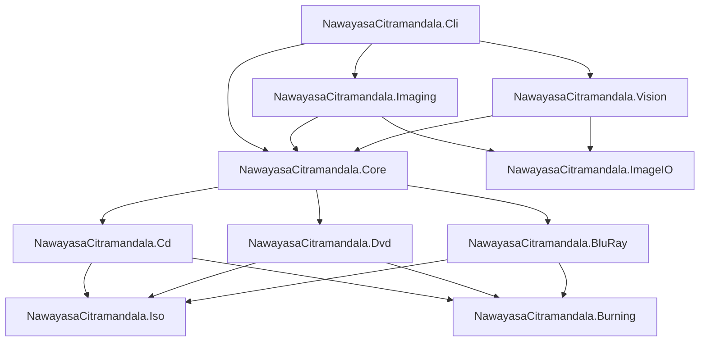

# Nawayasa Citramandala (DiscImageStudio Spinoff)

[](https://dotnet.microsoft.com/)
[-success.svg)](tests/NawayasaCitramandala.Tests/)
[](docs/ARCHITECTURE.md)
[](https://www.gnu.org/licenses/gpl-3.0)

> **Seni Visual Tingkat Lapisan Fisik pada Media Optik (CD, DVD, Blu-ray)**  
> *Spinoff & Evolusi Tingkat Lanjut dari DiscImageStudio (JiaFeiMiao-K-Cat/DiscImageStudio)*

---

## 🌟 Pengantar

**Nawayasa Citramandala** adalah studio perangkat lunak generasi baru untuk merancang, memodulasi, dan membakar karya seni visual langsung ke atas permukaan lapisan fisik piringan optik (CD-R, DVD-R, dan BD-R 25GB) menggunakan optical disc burner standar rumahan tanpa memerlukan drive khusus berlisensi (seperti Yamaha DiscT@2 atau Labelflash).

Proyek ini berbasis pada arsitektur luar biasa dari [JiaFeiMiao-K-Cat/DiscImageStudio](https://github.com/JiaFeiMiao-K-Cat/DiscImageStudio), yang memodulasi data biner, run-length coding (EFM, EFMPlus, 17PP), dan interleaving fisik (CIRC, RS-PC, LDC/BIS) agar kontras optik mikroskopis (*pit*, *land*, dan *transition density*) membentuk gambar yang tampak jelas oleh mata telanjang (*visible naked-eye artwork*).

---

## 🔬 Fondasi Ilmiah & Model Fisik

| Tipe Media | Standar Internasional | Skema Modulasi / Encoding | Prinsip Pembentukan Gambar Visual |
| :--- | :--- | :--- | :--- |
| **CD-R** | ECMA-130, ECMA-394, Red Book | EFM (8-to-14 Modulation), CIRC Interleaving (111-frame latency) | Modulasi nilai byte kontras (`0x0D` gelap vs `0xAA` terang). Format Audio CD-DA (WAV/CUE) atau Mode 1 Data. |
| **DVD-R** | ECMA-267, ECMA-359 | EFMPlus (16-bit channel code, 4 States), RS-PC (PO 208×16, PI 182×10), LFSR Scrambler | Modulasi densitas transisi EFMPlus (*dispersion mode*): `0xA5` (5 transisi/simbol $\rightarrow$ gelap) vs `0x92` (2 transisi/simbol $\rightarrow$ terang). Inversi pengacak $P = Q \oplus \text{mask}$. |
| **BD-R** (25 GB) | ISO/IEC 30190 | 17PP (RLL 1,7 Parity Preserve), LDC+BIS ECC, DC bit insertion | Bias run-length 3T vs 6T: `0xAA` (85.4% 3T $\rightarrow$ hamburan tinggi) vs `0x44` (62.7% 6T $\rightarrow$ refleksi cermin), sistem berkas UDF 2.01. |

### Model Geometri Spiral & Presisi Pitch
- **Spiral Archimedes Presisi**: Pemetaan koordinat polar $(r, \theta)$ ke Linear Block Address (LBA) / Physical Sector Number (PSN).
- **Polinomial Pitch Orde-3**: 
  $$p(x) = p_0 \cdot \left(1 + c_1 x + c_2 x^2 + c_3 x^3\right)$$
  untuk mengeliminasi distorsi lengkung garis radial akibat variasi manufaktur piringan.
- **Sistem Kalibrasi Terotomasi Computer Vision**: Deteksi $x_0, y_0, r_i, r_o$ dan koefisien lengkung pitch melalui pemrosesan citra otonom via `NawayasaCitramandala.Vision`.

---

## 🏗️ Arsitektur Solusi & Monorepo

Solusi terdiri dari 11 proyek modular di bawah .NET 9 LTS/STS:



### Rincian Modul:
1. [**`NawayasaCitramandala.Core`**](src/NawayasaCitramandala.Core/README.md): Kontrak antarmuka `IOpticalDiscModule`, geometri spiral `DvdTrackGeometry`, Void-and-Cluster `BlueNoiseGrayscale`, dan kurva gamma `DyeProfile`.
2. [**`NawayasaCitramandala.ImageIO`**](src/NawayasaCitramandala.ImageIO/README.md): Pemuat dan penyimpan raster cross-platform murni via `StbImageSharp` & `StbImageWriteSharp`.
3. [**`NawayasaCitramandala.Imaging`**](src/NawayasaCitramandala.Imaging/README.md): Kanvas polar multi-resolusi dan pemrosesan dither (Blue Noise, Floyd-Steinberg, Atkinson, Bayer 4×4).
4. [**`NawayasaCitramandala.Vision`**](src/NawayasaCitramandala.Vision/README.md): Modul Computer Vision otonom untuk deteksi spindle piringan dan regresi koefisien pitch $c_1, c_2, c_3$.
5. [**`NawayasaCitramandala.Cd`**](src/NawayasaCitramandala.Cd/README.md): Generator CD-DA Audio PCM, koreksi latensi CIRC 111-frame, dan pembentukan berkas WAV/CUE.
6. [**`NawayasaCitramandala.Dvd`**](src/NawayasaCitramandala.Dvd/README.md): Solver kendali state NRZI, kalkulator RS-PC ECC over $GF(2^8)$, pengacak LFSR, dan modulasi dispersi $Q = 0xA5 / 0x92$.
7. [**`NawayasaCitramandala.BluRay`**](src/NawayasaCitramandala.BluRay/README.md): Modulasi 17PP RLL(1,7), penyisipan bit kendali DC, pembentukan kluster RUB 496 frame, dan bias run-length 3T vs 6T.
8. [**`NawayasaCitramandala.Iso`**](src/NawayasaCitramandala.Iso/README.md): Generator ISO9660 (Joliet) dan UDF 2.01 dengan alokasi berkas hibrida (inner hub vs outer rim).
9. [**`NawayasaCitramandala.Burning`**](src/NawayasaCitramandala.Burning/README.md): Pipa pembakaran streaming Windows IMAPI2 dengan ring buffer sirkuler 64 MiB.
10. [**`NawayasaCitramandala.Cli`**](src/NawayasaCitramandala.Cli/README.md): Aplikasi command-line interaktif dengan sub-perintah `autocalibrate`, `dither`, `cd-generate`, `solve`, dan `bd-generate`.
11. [**`NawayasaCitramandala.Tests`**](tests/NawayasaCitramandala.Tests/README.md): Rangkaian pengujian unit terotomasi xUnit dengan tingkat kelulusan 100% (11 passed, 0 failed).

---

## ⚡ Panduan Cepat (Quickstart)

### Prasyarat
- [.NET 9.0 SDK](https://dotnet.microsoft.com/download/dotnet/9.0) atau lebih baru.
- Windows 10/11 (untuk modul pembakaran IMAPI2) atau Linux/macOS (untuk modul sintesis ISO/WAV).

### Kompilasi & Pengujian
```bash
# Clone repositori
git clone https://github.com/y7thangeru/Nawayasa-Citramandala.git
cd Nawayasa-Citramandala

# Jalankan pengujian unit
dotnet test

# Jalankan aplikasi CLI
dotnet run --project src/NawayasaCitramandala.Cli -- --help
```

### Contoh Penggunaan CLI

#### 1. Auto-Kalibrasi dari Foto Piringan
```bash
dotnet run --project src/NawayasaCitramandala.Cli -- autocalibrate --photo samples/disc_photo.png --out presets/calibrated_dvd.json
```

#### 2. Dithering Gambar dengan Blue Noise & Profil Dye AZO
```bash
dotnet run --project src/NawayasaCitramandala.Cli -- dither --input artwork.png --output artwork_dithered.png --method bluenoise --dye azo
```

#### 3. Membuat Berkas ISO DVD-R Visual
```bash
dotnet run --project src/NawayasaCitramandala.Cli -- solve --image artwork_dithered.png --out output_dvd.iso --preset-file presets/calibrated_dvd.json
```

#### 4. Membuat Audio CD-DA Visual (WAV + CUE)
```bash
dotnet run --project src/NawayasaCitramandala.Cli -- cd-generate --image artwork_dithered.png --out output_cd.wav
```

---

## 📚 Dokumentasi Lengkap

- 📐 [**Mathematical Foundations & Physical Layer**](docs/PHYSICAL_LAYER_MATH.md) — Penjelasan detail rumus spiral Archimedes, kalkulasi polinomial pitch, EFM, EFMPlus 4-state, RS-PC $GF(2^8)$, dan 17PP.
- 🏛️ [**Architecture & System Design**](docs/ARCHITECTURE.md) — Gambaran arsitektur sistem, streaming pipeline, dan pembagian tanggung jawab modul.
- 🎯 [**Calibration Guide**](docs/CALIBRATION_GUIDE.md) — Panduan lengkap kalibrasi fotografi piringan, auto-kalibrasi Computer Vision, dan fine-tuning manual.
- 💻 [**CLI Reference**](docs/CLI_REFERENCE.md) — Panduan lengkap parameter dan opsi baris perintah.
- 📋 [**Feature Lifecycle Tracking**](Feature-ToBe-Implemented.md) — Status pelacakan fitur dan milestone proyek.
- 📝 [**Update Tracker (Audit Log)**](update_tracker.md) — Riwayat perubahan berkas dan audit log.
- 📑 [**Consolidated Master Report**](Report-To-GeminiProject.md) — Laporan komprehensif master all-in-one.

---

## 📁 Struktur Direktori

```
NawayasaCitramandala_discImageStudio/
├── docs/                       # Dokumentasi teknis mendalam
│   ├── ARCHITECTURE.md
│   ├── PHYSICAL_LAYER_MATH.md
│   ├── CALIBRATION_GUIDE.md
│   └── CLI_REFERENCE.md
├── src/                        # Modul-modul sumber C# .NET 9
│   ├── NawayasaCitramandala.Core/
│   ├── NawayasaCitramandala.ImageIO/
│   ├── NawayasaCitramandala.Imaging/
│   ├── NawayasaCitramandala.Iso/
│   ├── NawayasaCitramandala.Cd/
│   ├── NawayasaCitramandala.Dvd/
│   ├── NawayasaCitramandala.BluRay/
│   ├── NawayasaCitramandala.Burning/
│   ├── NawayasaCitramandala.Vision/
│   └── NawayasaCitramandala.Cli/
├── tests/                      # Rangkaian pengujian unit xUnit
│   └── NawayasaCitramandala.Tests/
├── upstream_repo/              # Referensi sumber asli DiscImageStudio v1.4.0
├── Directory.Build.props       # Properti build terpusat & InternalsVisibleTo
├── NawayasaCitramandala.sln    # Solution file
├── update_tracker.md           # Audit logging pembaruan
├── Feature-ToBe-Implemented.md # Pelacakan siklus hidup fitur
├── README.md                   # Ringkasan utama proyek
└── Report-To-GeminiProject.md  # Laporan konsolidasi master all-in-one
```

---

## ⚖️ Lisensi & Penghargaan

- Proyek ini berbasis pada [DiscImageStudio](https://github.com/JiaFeiMiao-K-Cat/DiscImageStudio) oleh **JiaFeiMiao-K-Cat**, didistribusikan di bawah lisensi **GNU General Public License v3.0 or later (GPL-3.0-or-later)**.
- Penghargaan mendalam kepada JiaFeiMiao-K-Cat dan komunitas atas riset perintis pada lapisan fisik optik CD/DVD/BD.
