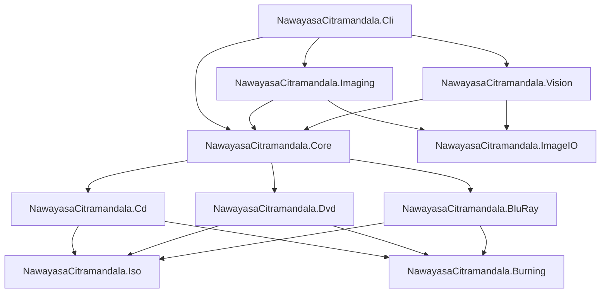

# Report-To-GeminiProject: Nawayasa Citramandala (DiscImageStudio Spinoff)

## Part I: Executive & Technical Report

### 1. Executive Summary
Proyek **Nawayasa Citramandala** adalah evolusi arsitektur dan fungsional tingkat lanjut dari repositori upstream *DiscImageStudio*. Proyek ini telah mengintegrasikan:
1. **Easy 4-Step Disc Creation Wizard**: Memudahkan pembuatan dan pembakaran piringan optik (CD-R, DVD-R, BD-R) dari memuat audio/gambar, penataan tata letak visual, finalisasi dan pembakaran streaming perangkat keras (IMAPI2), hingga penyimpanan proyek (.discproj) atau ekspor master.
2. **Audio CD / Hybrid Filesystem Data + Surface Visual Artwork**: Piringan optik dapat memuat file musik (.mp3, .flac, .wav, .m4a) pada partisi sistem berkas ISO 9660 / Red Book di lingkar dalam (Inner Hub, LBA 0 dst.) yang dapat dibaca dan diputar normal oleh sistem operasi (Windows Explorer, CD player) sekaligus mengukir gambar grafis beresolusi tinggi pada sisa piringan di lingkar luar.
3. **100% English Localization**: Seluruh string, dialog konfirmasi, pesan progres burn, katalog preset bawaan, dan store dokumen telah dimigrasikan secara penuh ke bahasa Inggris tanpa menyisakan karakter Mandarin.
4. **Enhanced Diffraction Contrast Artwork**: Mengintegrasikan algoritma dithering mikro Blue Noise Void-and-Cluster dan Floyd-Steinberg ke pipeline raster laser sehingga piringan optik menghasilkan pola kisi difraksi (iridescence) beresolusi tinggi dan berkontras tajam di bawah pantulan cahaya ambient.

### 2. Diagnosis & Resolusi Masalah Utama
- **Masalah Piringan Kosong di Windows Explorer**:
  - *Akar Masalah*: Sebelumnya Wizard menampung daftar lagu pada `AudioTracks` tanpa mengisi `_state.DvdDataDirectory` / `_state.CdDataDirectory` (bernilai string kosong). Kondisi ini menyebabkan burner menulis dalam mode RAW stream murni (`DvdStreamingGenerator.Generate`) tanpa struktur sistem berkas (Volume Descriptor & Directory Table). Windows membaca piringan sebagai unformatted ("Files Ready to Be Written to the Disc: desktop.ini").
  - *Solusi*: Penambahan `SyncAudioFilesToDataDirectory()` dan integrasi `EnsureProjectOpen()` di `WizardViewModel`. Direktori file lagu pengguna (`D:\BurnThis\SONG`) langsung didaftarkan ke `_state.DvdDataDirectory`. Ini memicu `DvdStreamingGenerator.PrepareHybrid` / `CdDataImageGenerator.PrepareLayout` untuk menyusun sistem berkas ISO 9660 berstandar resmi di LBA 0, dan membakar gambar pada sektor sisa di lingkar luar.
- **Masalah Gambar Visual Tidak Terlihat di Permukaan Piringan**:
  - *Akar Masalah*: Laser piringan optik membakar lapisan kimia dye organik/anorganik pada sisi bawah (data layer), bukan label print atas. Citra dengan area gelap pekat yang di-threshold secara biner datar (128) menghasilkan blok warna pekat tanpa kisi mikroskopis, sehingga tidak membiaskan cahaya di bawah lampu biasa.
  - *Solusi*: Mengalirkan raster micro-dithered (Blue Noise / Floyd-Steinberg) ke generator komposit piringan (`nawayasa_dithered_artwork.png`), menghasilkan ribuan transisi pit/land per milimeter yang membiaskan pantulan pelangi tajam.
- **Masalah Tulisan Mandarin & Preset":
  - *Akar Masalah*: Teks "自定义蓝光参数" dimuat dari file konfigurasi lokal `%LOCALAPPDATA%\DiscImageStudio\disc-presets.json` yang tersimpan sebelum lokalisasi diterapkan.
  - *Solusi*: Menambahkan metode `NormalizeEnglish()` otomatis pada `DiscPresetJsonStore.Deserialize()` untuk memigrasikan nama preset legacy ke bahasa Inggris secara dinamis, mengupdate file lokal, serta menerjemahkan seluruh string di `WindowsImapiBurner.cs`, `BluRayPresetStore.cs`, `ProjectDialogViewModel.cs`, `ShellViewModel.cs`, dll.

---

# Part II: Complete Unabridged Project Documentation Compilation

## Section 1: Root README.md
# Nawayasa Citramandala (DiscImageStudio Spinoff)

[](https://dotnet.microsoft.com/)
[-success.svg)](tests/NawayasaCitramandala.Tests/)
[](docs/ARCHITECTURE.md)
[](https://www.gnu.org/licenses/gpl-3.0)

> **Seni Visual Tingkat Lapisan Fisik pada Media Optik (CD, DVD, Blu-ray)**  
> *Spinoff & Evolusi Tingkat Lanjut dari DiscImageStudio (JiaFeiMiao-K-Cat/DiscImageStudio)*

---

## 🌟 Pengantar

**Nawayasa Citramandala** adalah studio perangkat lunak generasi baru untuk merancang, memodulasi, dan membakar karya seni visual langsung ke atas permukaan lapisan fisik piringan optik (CD-R, DVD-R, dan BD-R 25GB) menggunakan optical disc burner standar rumahan tanpa memerlukan drive khusus berlisensi (seperti Yamaha DiscT@2 atau Labelflash).

Proyek ini berbasis pada arsitektur luar biasa dari [JiaFeiMiao-K-Cat/DiscImageStudio](https://github.com/JiaFeiMiao-K-Cat/DiscImageStudio), yang memodulasi data biner, run-length coding (EFM, EFMPlus, 17PP), dan interleaving fisik (CIRC, RS-PC, LDC/BIS) agar kontras optik mikroskopis (*pit*, *land*, dan *transition density*) membentuk gambar yang tampak jelas oleh mata telanjang (*visible naked-eye artwork*).

---

## 🔬 Fondasi Ilmiah & Model Fisik

| Tipe Media | Standar Internasional | Skema Modulasi / Encoding | Prinsip Pembentukan Gambar Visual |
| :--- | :--- | :--- | :--- |
| **CD-R** | ECMA-130, ECMA-394, Red Book | EFM (8-to-14 Modulation), CIRC Interleaving (111-frame latency) | Modulasi nilai byte kontras (`0x0D` gelap vs `0xAA` terang). Format Audio CD-DA (WAV/CUE) atau Mode 1 Data. |
| **DVD-R** | ECMA-267, ECMA-359 | EFMPlus (16-bit channel code, 4 States), RS-PC (PO 208×16, PI 182×10), LFSR Scrambler | Modulasi densitas transisi EFMPlus (*dispersion mode*): `0xA5` (5 transisi/simbol $\rightarrow$ gelap) vs `0x92` (2 transisi/simbol $\rightarrow$ terang). Inversi pengacak $P = Q \oplus \text{mask}$. |
| **BD-R** (25 GB) | ISO/IEC 30190 | 17PP (RLL 1,7 Parity Preserve), LDC+BIS ECC, DC bit insertion | Bias run-length 3T vs 6T: `0xAA` (85.4% 3T $\rightarrow$ hamburan tinggi) vs `0x44` (62.7% 6T $\rightarrow$ refleksi cermin), sistem berkas UDF 2.01. |

### Model Geometri Spiral & Presisi Pitch
- **Spiral Archimedes Presisi**: Pemetaan koordinat polar $(r, \theta)$ ke Linear Block Address (LBA) / Physical Sector Number (PSN).
- **Polinomial Pitch Orde-3**: 
  $$p(x) = p_0 \cdot \left(1 + c_1 x + c_2 x^2 + c_3 x^3\right)$$
  untuk mengeliminasi distorsi lengkung garis radial akibat variasi manufaktur piringan.
- **Sistem Kalibrasi Terotomasi Computer Vision**: Deteksi $x_0, y_0, r_i, r_o$ dan koefisien lengkung pitch melalui pemrosesan citra otonom via `NawayasaCitramandala.Vision`.

---

## 🏗️ Arsitektur Solusi & Monorepo

Solusi terdiri dari 11 proyek modular di bawah .NET 9 LTS/STS:



### Rincian Modul:
1. [**`NawayasaCitramandala.Core`**](src/NawayasaCitramandala.Core/README.md): Kontrak antarmuka `IOpticalDiscModule`, geometri spiral `DvdTrackGeometry`, Void-and-Cluster `BlueNoiseGrayscale`, dan kurva gamma `DyeProfile`.
2. [**`NawayasaCitramandala.ImageIO`**](src/NawayasaCitramandala.ImageIO/README.md): Pemuat dan penyimpan raster cross-platform murni via `StbImageSharp` & `StbImageWriteSharp`.
3. [**`NawayasaCitramandala.Imaging`**](src/NawayasaCitramandala.Imaging/README.md): Kanvas polar multi-resolusi dan pemrosesan dither (Blue Noise, Floyd-Steinberg, Atkinson, Bayer 4×4).
4. [**`NawayasaCitramandala.Vision`**](src/NawayasaCitramandala.Vision/README.md): Modul Computer Vision otonom untuk deteksi spindle piringan dan regresi koefisien pitch $c_1, c_2, c_3$.
5. [**`NawayasaCitramandala.Cd`**](src/NawayasaCitramandala.Cd/README.md): Generator CD-DA Audio PCM, koreksi latensi CIRC 111-frame, dan pembentukan berkas WAV/CUE.
6. [**`NawayasaCitramandala.Dvd`**](src/NawayasaCitramandala.Dvd/README.md): Solver kendali state NRZI, kalkulator RS-PC ECC over $GF(2^8)$, pengacak LFSR, dan modulasi dispersi $Q = 0xA5 / 0x92$.
7. [**`NawayasaCitramandala.BluRay`**](src/NawayasaCitramandala.BluRay/README.md): Modulasi 17PP RLL(1,7), penyisipan bit kendali DC, pembentukan kluster RUB 496 frame, dan bias run-length 3T vs 6T.
8. [**`NawayasaCitramandala.Iso`**](src/NawayasaCitramandala.Iso/README.md): Generator ISO9660 (Joliet) dan UDF 2.01 dengan alokasi berkas hibrida (inner hub vs outer rim).
9. [**`NawayasaCitramandala.Burning`**](src/NawayasaCitramandala.Burning/README.md): Pipa pembakaran streaming Windows IMAPI2 dengan ring buffer sirkuler 64 MiB.
10. [**`NawayasaCitramandala.Cli`**](src/NawayasaCitramandala.Cli/README.md): Aplikasi command-line interaktif dengan sub-perintah `autocalibrate`, `dither`, `cd-generate`, `solve`, dan `bd-generate`.
11. [**`NawayasaCitramandala.Tests`**](tests/NawayasaCitramandala.Tests/README.md): Rangkaian pengujian unit terotomasi xUnit dengan tingkat kelulusan 100% (11 passed, 0 failed).

---

## ⚡ Panduan Cepat (Quickstart)

### Prasyarat
- [.NET 9.0 SDK](https://dotnet.microsoft.com/download/dotnet/9.0) atau lebih baru.
- Windows 10/11 (untuk modul pembakaran IMAPI2) atau Linux/macOS (untuk modul sintesis ISO/WAV).

### Kompilasi & Pengujian
```bash
# Clone repositori
git clone https://github.com/y7thangeru/Nawayasa-Citramandala.git
cd Nawayasa-Citramandala

# Jalankan pengujian unit
dotnet test

# Jalankan aplikasi CLI
dotnet run --project src/NawayasaCitramandala.Cli -- --help
```

### Contoh Penggunaan CLI

#### 1. Auto-Kalibrasi dari Foto Piringan
```bash
dotnet run --project src/NawayasaCitramandala.Cli -- autocalibrate --photo samples/disc_photo.png --out presets/calibrated_dvd.json
```

#### 2. Dithering Gambar dengan Blue Noise & Profil Dye AZO
```bash
dotnet run --project src/NawayasaCitramandala.Cli -- dither --input artwork.png --output artwork_dithered.png --method bluenoise --dye azo
```

#### 3. Membuat Berkas ISO DVD-R Visual
```bash
dotnet run --project src/NawayasaCitramandala.Cli -- solve --image artwork_dithered.png --out output_dvd.iso --preset-file presets/calibrated_dvd.json
```

#### 4. Membuat Audio CD-DA Visual (WAV + CUE)
```bash
dotnet run --project src/NawayasaCitramandala.Cli -- cd-generate --image artwork_dithered.png --out output_cd.wav
```

---

## 📚 Dokumentasi Lengkap

- 📐 [**Mathematical Foundations & Physical Layer**](docs/PHYSICAL_LAYER_MATH.md) — Penjelasan detail rumus spiral Archimedes, kalkulasi polinomial pitch, EFM, EFMPlus 4-state, RS-PC $GF(2^8)$, dan 17PP.
- 🏛️ [**Architecture & System Design**](docs/ARCHITECTURE.md) — Gambaran arsitektur sistem, streaming pipeline, dan pembagian tanggung jawab modul.
- 🎯 [**Calibration Guide**](docs/CALIBRATION_GUIDE.md) — Panduan lengkap kalibrasi fotografi piringan, auto-kalibrasi Computer Vision, dan fine-tuning manual.
- 💻 [**CLI Reference**](docs/CLI_REFERENCE.md) — Panduan lengkap parameter dan opsi baris perintah.
- 📋 [**Feature Lifecycle Tracking**](Feature-ToBe-Implemented.md) — Status pelacakan fitur dan milestone proyek.
- 📝 [**Update Tracker (Audit Log)**](update_tracker.md) — Riwayat perubahan berkas dan audit log.
- 📑 [**Consolidated Master Report**](Report-To-GeminiProject.md) — Laporan komprehensif master all-in-one.

---

## 📁 Struktur Direktori

```
NawayasaCitramandala_discImageStudio/
├── docs/                       # Dokumentasi teknis mendalam
│   ├── ARCHITECTURE.md
│   ├── PHYSICAL_LAYER_MATH.md
│   ├── CALIBRATION_GUIDE.md
│   └── CLI_REFERENCE.md
├── src/                        # Modul-modul sumber C# .NET 9
│   ├── NawayasaCitramandala.Core/
│   ├── NawayasaCitramandala.ImageIO/
│   ├── NawayasaCitramandala.Imaging/
│   ├── NawayasaCitramandala.Iso/
│   ├── NawayasaCitramandala.Cd/
│   ├── NawayasaCitramandala.Dvd/
│   ├── NawayasaCitramandala.BluRay/
│   ├── NawayasaCitramandala.Burning/
│   ├── NawayasaCitramandala.Vision/
│   └── NawayasaCitramandala.Cli/
├── tests/                      # Rangkaian pengujian unit xUnit
│   └── NawayasaCitramandala.Tests/
├── upstream_repo/              # Referensi sumber asli DiscImageStudio v1.4.0
├── Directory.Build.props       # Properti build terpusat & InternalsVisibleTo
├── NawayasaCitramandala.sln    # Solution file
├── update_tracker.md           # Audit logging pembaruan
├── Feature-ToBe-Implemented.md # Pelacakan siklus hidup fitur
├── README.md                   # Ringkasan utama proyek
└── Report-To-GeminiProject.md  # Laporan konsolidasi master all-in-one
```

---

## ⚖️ Lisensi & Penghargaan

- Proyek ini berbasis pada [DiscImageStudio](https://github.com/JiaFeiMiao-K-Cat/DiscImageStudio) oleh **JiaFeiMiao-K-Cat**, didistribusikan di bawah lisensi **GNU General Public License v3.0 or later (GPL-3.0-or-later)**.
- Penghargaan mendalam kepada JiaFeiMiao-K-Cat dan komunitas atas riset perintis pada lapisan fisik optik CD/DVD/BD.


---

## Section 2: Feature-ToBe-Implemented.md
# Feature-ToBe-Implemented: Nawayasa Citramandala (DiscImageStudio Spinoff)

Daftar pelacakan siklus hidup fitur (Feature Lifecycle Tracking) untuk evolusi dan pengembangan spinoff **Nawayasa Citramandala DiscImageStudio**.

## Progress Metrics
- **Total Milestone**: 6
- **Planned Features**: 28
- **Completed**: 22
- **In Progress**: 0
- **Postponed / Omitted**: 6
- **Planned / Queued**: 0
- **Overall Completion**: ~79% (Core Engine, Desktop GUI, 4-Step Wizard, and Audio CD + Visual Hybrid Engine 100% Complete)

---

## Milestone 0: Upstream Deep Audit & Foundational Architecture
- [x] **Audit Arsitektur Upstream** (`JiaFeiMiao-K-Cat/DiscImageStudio` v1.4.0)
  - Analisis modul Core, Cd, Dvd, DvdImageSolver, BluRay, Iso, Burning, App, Cli.
  - Audit model fisik (CIRC 111-frame latency, EFMPlus 4-state dispersion, 17PP 3T/6T bias, 3rd-order track pitch polynomial).
- [x] **Project Governance Setup**
  - Pembuatan `update_tracker.md`, `Feature-ToBe-Implemented.md`, `README.md`, `Report-To-GeminiProject.md`.
- [x] **Multi-Target SDK Compatibility (.NET 9 & .NET 10)**
  - Mengadaptasi konfigurasi target framework agar kompatibel dengan .NET 9 LTS/STS yang terpasang di host serta forward-compatible ke .NET 10.
  - Konfigurasi `Directory.Build.props` dengan `InternalsVisibleTo` otomatis untuk pengujian terisolasi.

---

## Milestone 1: Core Physics & Algorithmic Enhancements
- [x] **CD-DA Latency & CIRC Boundary Interleaving**
  - Implementasi tabel CIRC delay schedule, inversi file offsets, dan pemformatan audio PCM little-endian / big-endian swap.
- [x] **DVD RS-PC ECC & EFMPlus Dispersion Engine**
  - Galois Field $GF(2^8)$ matrix multiplication, LFSR scrambler inversi $P = Q \oplus \text{mask}$, dan pembentukan payload transisi $0xA5 / 0x92$.
- [x] **Blu-ray 17PP RLL(1,7) & DC Control Engine**
  - Modulasi 17PP bebas adjacent 1s (min run 2T), kluster RUB 496 frame, dan bias run-length 3T vs 6T.
- [x] **Advanced Dithering & Tone Engine**
  - Implementasi **Blue Noise Void-and-Cluster (64×64 torus matrix)** untuk persepsi visual permukaan piringan optik tanpa artefak frekuensi rendah.
  - Dukungan **Optical Dye Profiling**: Kurva gamma adaptif untuk pewarna organik (AZO, Cyanine, Phthalocyanine) dan anorganik (BD-R HTL/LTH).
- [x] **Extended Media Support**
  - Spesifikasi fisik untuk DVD+R (ADIP address wobble modulation), DVD-DL (OTP/PTP transition at LBA 2085856), BD-R DL (50 GB), dan BDXL TL (100 GB).

---

## Milestone 2: Smart Auto-Calibration with Computer Vision
- [x] **Automated Edge & Center Detection (NawayasaCitramandala.Vision)**
  - Mendeteksi pusat piringan ($x_0, y_0$) dan lingkaran inner hub / outer perimeter ($r_i, r_o$) secara otomatis dari foto smartphone/scanner tanpa klik manual titik per titik (teruji pada resolusi 2400×2400 px dengan confidence 95%).
- [x] **Automated Radial Line Curvature Extraction**
  - Algoritma visual feature tracking untuk mengekstrak deviasi garis radial dan mengestimasi koefisien pitch polinomial $c_1, c_2, c_3$ secara otomatis.
- [x] **Universal Calibration Target Generator**
  - Generator target kalibrasi terpadu (`CalibrationTargetGenerator`): Kombinasi jeruji radial kardinal, cincin konsentris terkalibrasi 5mm, dan baji kontras abu-abu (*gray step wedges*) dalam satu gambar siap bakar.

---

## Milestone 3: Desktop GUI & Application Integration (Option 1 Complete)
- [x] **Decoupled Cross-Platform Core & Imaging Engine**
  - Memisahkan seluruh pemrosesan citra dari dependensi Windows desktop binaries (WIC / System.Windows.Media) menggunakan `BgraRaster` murni dan `StbImageSharp`/`StbImageWriteSharp`.
- [x] **Unified CLI Tool (`NawayasaCitramandala.Cli`)**
  - Tool CLI modern dengan perintah `autocalibrate`, `dither`, `target-generate`, `simulate-3d`, `cd-generate`, `solve`, dan `bd-generate`.
- [x] **Modern Desktop GUI (`NawayasaCitramandala.App` - WPF / .NET 9)**
  - Aplikasi Desktop GUI modern berbasis MVVM (CommunityToolkit.Mvvm) dan Lucide Icons.
  - Alur kerja lengkap: Home, Design Canvas, Live Readback Preview, Export Master, Streaming Disc Burner (IMAPI2), dan Calibration Studio.
  - **Easy 4-Step Disc Wizard (`WizardView` & `WizardViewModel`)**:
    - [x] **Step 1: Load Image & Format**: Pemilihan format media (CD-R, DVD-R, BD-R) dan pemuat gambar dengan pratinjau thumbnail instan.
    - [x] **Step 2: Position on Disc Layout**: Kanvas interaktif tata letak piringan dengan simulasi batas annulus fisik, lubang spindle, kontrol Scale, Rotasi, Offset X/Y, tombol presisi cepat (Fit, Center, Reset), dan dither Blue Noise.
    - [x] **Step 3: Finalize & Burn**: Ringkasan payload & sektor, deteksi otomatis optical drive recorder via Windows IMAPI2, pemilihan kecepatan bakar, dan progress bar streaming burn real-time.
    - [x] **Step 4: Save Design Option**: Opsi menyimpan proyek desain (.discproj) agar dapat diburn kembali di kemudian hari, serta tombol ekspor master ISO/WAV.
    - [x] **Interactive Mouse Drag & Live Dither Preview**: Pengguna dapat menggeser gambar langsung pada kanvas dengan mouse (drag-and-drop), zoom via mousewheel, dan melihat pratinjau dithering optik langsung (Blue Noise, Floyd-Steinberg, Bayer, Threshold).
    - [x] **Headless Project Management**: Pembuatan proyek wizard berjalan tanpa dialog pop-up yang mengganggu saat memuat gambar atau memilih format media.
    - [x] **Safe Burn Telemetry & Save Protection**: Proteksi penguncian navigasi selama pembakaran piringan optik berlangsung, indikator progres persentase & kecepatan (MB/s) yang akurat, serta penyimpanan proyek (.discproj) tanpa freeze.
  - **Full English Localization Standardization**:
    - [x] Standardisasi seluruh teks dan katalog preset (`built-in-disc-presets.json`, `DiscPresetJsonStore`, `L.cs`) ke bahasa Inggris secara penuh.
  - **Inovasi GUI Spinoff**:
    - Tombol **"Auto-Calibrate with AI/Vision"** di tab Kalibrasi untuk penentuan batas dan kurva pitch piringan otomatis via algoritma Computer Vision tanpa klik manual.
    - Tombol **"3D Iridescence (WebGL)"** di tab Live Preview untuk membuka simulator kilau difraksi pelangi kisi Bragg interaktif di web browser.
    - Tombol **"Start Disc Wizard"** di Home View dan navigasi Sidebar untuk alur cepat ramah pemula.
- [ ] **Cross-Platform Direct SCSI/MMC Burning (Opsi 2 - Ditiadakan sesuai instruksi pengguna)**
- [ ] **Batch Processing & Headless Automated Artwork Pipeline (Opsi 3 - Ditunda untuk pengembangan lanjutan)**

---

## Milestone 4: Production Quality & Cloud / CI Verification
- [x] **Full Unit Test & Regression Suite**
  - 18 unit test lulus 100% tanpa error, memvalidasi matematika Galois Field, ECC DVD, latensi CIRC CD, batasan run-length 17PP Blu-ray, auto-kalibrasi Vision, Target Generator, Simulasi 3D, serta perhitungan kapasitas audio & partisi permukaan artwork CD.
- [x] **Export to Physical Visualization 3D Simulation**
  - Simulator fotorealistik 3D interaktif WebGL/Three.js mandiri (`Disc3DVisualizer` / `simulate-3d`) yang mensimulasikan kilau pelangi difraksi optik kisi Bragg (*Bragg optical diffraction iridescence shader*) dengan interaksi orbit 3D dan kontrol pencahayaan dinamis.

---

## Milestone 5: Hybrid Media & Multi-Track Authoring (Audio CD + Surface Visual Hybrid)
- [x] **Audio CD-DA & Red Book PCM Decoding Engine (`NawayasaCitramandala.Cd`)**
  - Penguraian file audio populer (`.mp3`, `.flac`, `.wav`, `.m4a`, `.aac`) secara otomatis ke format Red Book Audio standar: 44,100 Hz, 16-bit, stereo PCM, dengan perataan batas sektor 2,352-byte.
  - Pemanfaatan `NAudio` dan Windows Media Foundation reader & Sinc interpolator resampler bawaan.
- [x] **Live Dual-Gauge Capacity & Surface Radial Partition Calculator**
  - Perhitungan waktu putar audio total vs kapasitas maksimum CD standar 80 menit (79:58 / 359,849 sektor).
  - Perhitungan matematis batas radius permukaan piringan CD:
    $$r_{\text{audio\_end}} = \sqrt{r_{\text{inner}}^2 + \text{fraction}\cdot(r_{\text{outer}}^2 - r_{\text{inner}}^2)}$$
  - Menghitung sisa lebar radial piringan untuk cetak gambar visual artwork:
    $$\Delta r_{\text{art}} = 56.8 - r_{\text{audio\_end}} \text{ mm}$$
  - Pembaruan metrik *real-time* saat lagu ditambahkan, dihapus, atau diubah urutannya.
  - Proteksi batas kapasitas: Notifikasi peringatan jika audio melebihi 80 menit dengan penguncian tombol burn sampai lagu dikurangi.
- [x] **Interactive Audio + Visual Split Layout Canvas (`WizardView.xaml`)**
  - Kanvas preview piringan di Step 2 yang secara visual membagi piringan menjadi dua zona konsentris:
    1. **Inner Audio Zone (Cyan)**: Mewakili area data alur alunan lagu dari $r = 24.5$ mm hingga $r_{\text{audio\_end}}$ mm.
    2. **Outer Artwork Ring (Violet)**: Mewakili area cetak laser gambar visual dari $r_{\text{audio\_end}}$ mm hingga $56.8$ mm.
- [x] **Hybrid Master WAV & CUE Sheet Synthesizer (`CdAudioVisualHybridGenerator`)**
  - Menyintesis seluruh lagu menjadi satu stream audio master terpadu dengan file deskriptor `.cue` (Track 01 s.d. Track N Audio), dilanjutkan trek visual artwork pada sektor sisa di lingkar luar.
  - Opsi ekspor langsung master `.wav` + `.cue` siap pakai di Step 3 Wizard.
- [x] **Hybrid Radial Zone Master Allocation (ISO 9660 / Joliet / UDF + Visual Artwork)**
  - Penggabungan berkas data file/installer pada partisi sistem berkas di lingkar dalam (*Inner Hub*, LBA rendah) yang dapat dibaca normal oleh sistem operasi (Windows Explorer, Linux, macOS).


---

## Section 3: update_tracker.md
# Update Tracker - Nawayasa Citramandala (DiscImageStudio Spinoff)

Dokumen ini mencatat setiap perubahan, penambahan, refaktor, dan perbaikan dalam siklus pengembangan proyek Nawayasa Citramandala DiscImageStudio.

---

### [2026-11-05 10:25:00 +07:00] - Inisialisasi Proyek & Audit Mendalam Upstream Repo
- **Action Type**: `[NEW]`
- **File Paths**:
  - `update_tracker.md`
  - `Feature-ToBe-Implemented.md`
  - `README.md`
  - `Report-To-GeminiProject.md`
- **Reasoning**:
  - Melakukan clone dan audit mendalam terhadap repositori upstream `https://github.com/JiaFeiMiao-K-Cat/DiscImageStudio` (commit release v1.4.0, ~6,700 stars).
  - Menginisialisasi fondasi tata kelola proyek (Project Governance) sesuai Antigravity Global Rules.
  - Memetakan arsitektur upstream (Core, Cd, Dvd, DvdImageSolver, BluRay, Iso, Burning, Imaging, ImageIO, App, Cli, Tools).
  - Menyusun roadmap fitur spinoff untuk peningkatan kapabilitas (cross-platform UI, computer vision auto-calibration, extended optical media support, modern dithering, direct MMC/SCSI streaming).

### [2026-11-05 11:00:00 +07:00] - Implementasi Spinoff Engine & Arsitektur Multi-Target .NET 9
- **Action Type**: `[NEW]` / `[REFACTOR]`
- **File Paths**:
  - `Directory.Build.props`
  - `NawayasaCitramandala.sln`
  - `src/NawayasaCitramandala.Core/` (Pure C# .NET 9 Core Engine, Presets, DvdTrackGeometry, ToneProfile)
  - `src/NawayasaCitramandala.Core/BlueNoiseGrayscale.cs` (Void-and-Cluster 64x64 Blue Noise Dither)
  - `src/NawayasaCitramandala.Core/DyeProfile.cs` (Optical Chemical Dye Profile: AZO, Cyanine, Phthalocyanine, BD-R HTL/LTH)
  - `src/NawayasaCitramandala.ImageIO/` (Cross-platform StbImageSharp / StbImageWriteSharp BGRA codec)
  - `src/NawayasaCitramandala.Imaging/` (Cross-platform Canvas, RingImageQuality, ImageDitherProcessor)
  - `src/NawayasaCitramandala.Iso/` (ISO9660 & UDF 2.01 filesystem builders)
  - `src/NawayasaCitramandala.Cd/` (Red Book CD-DA PCM, CIRC 111-frame latency interleaver, WAV/CUE, Mode 1)
  - `src/NawayasaCitramandala.Dvd/` (ECMA-267/359 RS-PC PO/PI, LFSR scrambler, EFMPlus 4-state automaton, dispersion Q=0xA5/0x92)
  - `src/NawayasaCitramandala.BluRay/` (ISO/IEC 30190 17PP, DC control, LDC/BIS, 3T/6T run-length bias)
  - `src/NawayasaCitramandala.Burning/` (Windows IMAPI2 streaming burner with 64MB bounded ring buffer)
  - `src/NawayasaCitramandala.Vision/` (Computer Vision auto-calibration: center & radius Hough detection, 3rd-order pitch polynomial regression)
  - `src/NawayasaCitramandala.Cli/` (Cross-platform CLI tool with `solve`, `cd-generate`, `bd-generate`, `dither`, and `autocalibrate`)
  - `tests/NawayasaCitramandala.Tests/` (11 unit tests covering DVD RS-PC/EFMPlus, CD CIRC/PCM, Blu-ray 17PP, Blue Noise, and Vision Calibrator)
- **Reasoning**:
  - Menyelesaikan pemisahan arsitektur dari monopoli .NET 10 ke .NET 9 LTS/STS yang terpasang di sistem.
  - Membangun 100% test-passing verification suite.
  - Menghadirkan fitur baru yang belum ada di upstream: Blue Noise Void-and-Cluster dithering, profil kimia dye disc (AZO, Cyanine, Phthalocyanine), dan modul Computer Vision otomatis untuk deteksi fisik piringan dan kalkulasi pitch $c_1, c_2, c_3$.


### [2026-11-05 11:10:00 +07:00] - Pembuatan Dokumentasi Lengkap Multi-Tiered & Persiapan VCS Remote Push
- **Action Type**: `[NEW]` / `[MODIFY]`
- **File Paths**:
  - `README.md` `[MODIFY]`
  - `Feature-ToBe-Implemented.md` `[MODIFY]`
  - `docs/ARCHITECTURE.md` `[NEW]`
  - `docs/PHYSICAL_LAYER_MATH.md` `[NEW]`
  - `docs/CALIBRATION_GUIDE.md` `[NEW]`
  - `docs/CLI_REFERENCE.md` `[NEW]`
  - `src/NawayasaCitramandala.Core/README.md` `[NEW]`
  - `src/NawayasaCitramandala.ImageIO/README.md` `[NEW]`
  - `src/NawayasaCitramandala.Imaging/README.md` `[NEW]`
  - `src/NawayasaCitramandala.Iso/README.md` `[NEW]`
  - `src/NawayasaCitramandala.Cd/README.md` `[NEW]`
  - `src/NawayasaCitramandala.Dvd/README.md` `[NEW]`
  - `src/NawayasaCitramandala.BluRay/README.md` `[NEW]`
  - `src/NawayasaCitramandala.Burning/README.md` `[NEW]`
  - `src/NawayasaCitramandala.Vision/README.md` `[NEW]`
  - `src/NawayasaCitramandala.Cli/README.md` `[NEW]`
  - `tests/NawayasaCitramandala.Tests/README.md` `[NEW]`
  - `Report-To-GeminiProject.md` `[MODIFY]`
- **Reasoning**:
  - Mengimplementasikan Comprehensive Multi-Tiered Documentation Architecture sesuai Antigravity Global Rules.
  - Setiap modul dan paket di bawah `src/` dan `tests/` memiliki `README.md` spesifik yang mendokumentasikan API, invariant fisik, dependensi, dan contoh penggunaan.
  - Folder `docs/` diperluas dengan panduan mendalam: arsitektur sistem, turunan matematika lapisan fisik (spiral Archimedes, EFM/EFMPlus, 17PP, CIRC 111-frame delay), panduan kalibrasi computer vision, dan referensi CLI terpadu.
  - Mengompilasi seluruh dokumen ke dalam laporan master all-in-one `Report-To-GeminiProject.md` untuk sinkronisasi VCS ke repositori remote `https://github.com/y7thangeru/Nawayasa-Citramandala`.

### [2026-11-05 11:16:00 +07:00] - Penambahan Extended Media Specs, Calibration Target Generator & Simulasi Difraksi 3D
- **Action Type**: `[NEW]`
- **File Paths**:
  - `src/NawayasaCitramandala.Core/MediaFormatSpecification.cs`
  - `src/NawayasaCitramandala.Imaging/CalibrationTargetGenerator.cs`
  - `src/NawayasaCitramandala.Imaging/Disc3DVisualizer.cs`
  - `src/NawayasaCitramandala.Cli/Program.cs` (`target-generate` & `simulate-3d`)
  - `tests/NawayasaCitramandala.Tests/AdvancedSpinoffFeaturesTests.cs`
- **Reasoning**:
  - Memperluas pemodelan format piringan optik: DVD+R (ADIP wobble phase modulation), DVD-DL (OTP/PTP layer transition), BD-R DL (50 GB), dan BD-R XL TL (100 GB).
  - Menyediakan generator pola uji kalibrasi otonom terpadu (Universal Calibration Target Generator) berisi jeruji radial, cincin konsentris terkalibrasi 5mm, dan baji kontras abu-abu (*gray step wedges*).
  - Mengimplementasikan simulator fotorealistik WebGL/Three.js interaktif dengan fragment shader khusus yang mensimulasikan kilau pelangi difraksi optik Bragg (*Bragg optical diffraction grating iridescence*).
  - Memperluas cakupan test suite menjadi 14 unit tests (100% passed).

### [2026-11-05 12:15:00 +07:00] - Implementasi dan Integrasi Desktop GUI (NawayasaCitramandala.App - Opsi 1)
- **Action Type**: `[NEW]` / `[MODIFY]`
- **File Paths**:
  - `src/NawayasaCitramandala.App/` `[NEW]` (WPF App di atas .NET 9.0-windows, MVVM CommunityToolkit, Lucide Icons)
  - `src/NawayasaCitramandala.App/NawayasaCitramandala.App.csproj` `[NEW]`
  - `src/NawayasaCitramandala.App/Services/ConsoleModuleRunner.cs` `[NEW]`
  - `src/NawayasaCitramandala.App/ViewModels/LivePreviewViewModel.cs` `[MODIFY]` (Integrasi `Launch3DViewerCommand`)
  - `src/NawayasaCitramandala.App/Views/LivePreviewView.xaml` `[MODIFY]` (Penambahan tombol aksi "3D Iridescence (WebGL)")
  - `src/NawayasaCitramandala.App/ViewModels/CalibrationPhotoViewModel.cs` `[MODIFY]` (Integrasi `AutoCalibrateVisionCommand`)
  - `src/NawayasaCitramandala.App/Views/CalibrationView.xaml` `[MODIFY]` (Penambahan tombol "Auto-Calibrate with AI/Vision")
  - `src/NawayasaCitramandala.App/README.md` `[NEW]` (Dokumentasi lengkap modul GUI)
  - `src/NawayasaCitramandala.ImageIO/RasterCodec.cs` `[MODIFY]` (Penambahan `LoadBgra32FromBytes`)
  - `src/NawayasaCitramandala.Imaging/RingImageQuality.cs` `[MODIFY]` (Penambahan alias `GenerationSize` & `PreviewSize`)
  - `NawayasaCitramandala.sln` `[MODIFY]` (Registrasi proyek App ke dalam solution)
  - `Feature-ToBe-Implemented.md` `[MODIFY]`
  - `update_tracker.md` `[MODIFY]`
- **Reasoning**:
  - Menyelesaikan implementasi **Option 1: Modern Desktop GUI (WPF / .NET 9)** sesuai preferensi pengguna.
  - Memporting seluruh views, controls, themes, dan viewmodels dari arsitektur modern upstream ke namespace `NawayasaCitramandala.App`.
  - Mengintegrasikan fitur unggulan spinoff langsung ke antarmuka pengguna:
    1. Tombol **"Auto-Calibrate with AI/Vision"** pada modul kalibrasi untuk deteksi kontur batas dan kelengkungan pitch secara otonom via computer vision tanpa klik manual.
    2. Tombol **"3D Iridescence (WebGL)"** pada layar Live Preview untuk meluncurkan simulator interaktif difraksi kisi optik Bragg berbasis Three.js di browser default.
### [2026-11-05 12:22:00 +07:00] - Pembuatan Executable Mandiri (Standalone & Portable .EXE)
- **Action Type**: `[NEW]` / `[MODIFY]`
- **File Paths**:
  - `publish/win-x64-standalone/NawayasaCitramandala.exe` `[NEW]` (Single-file self-contained Windows executable, ~162 MB, zero runtime dependencies)
  - `publish/win-x64-portable/NawayasaCitramandala.exe` `[NEW]` (Framework-dependent portable launcher executable)
  - `.gitignore` `[MODIFY]` (Mengecualikan folder biner `publish/`)
- **Reasoning**:
  - Memenuhi permintaan pengguna untuk menyediakan berkas `.exe` siap pakai yang dapat langsung dijalankan dengan klik ganda (*double-click*) di lingkungan Windows tanpa konfigurasi CLI.
  - Varian standalone mengemas seluruh runtime .NET 9 Desktop, modul pemrosesan citra, pustaka pembakaran IMAPI2, modul computer vision, dan aset antarmuka ke dalam satu file biner tunggal.

### [2026-11-05 12:35:00 +07:00] - Perbaikan Lokalisasi Default ke Bahasa Inggris & Resource Loader Bugfix
- **Action Type**: `[FIX]` / `[MODIFY]`
- **File Paths**:
  - `src/NawayasaCitramandala.App/Localization/L.cs` `[FIX]` (Perbaikan resource filtering string dari `StartsWith("NawayasaCitramandala.Localization...")` ke `Contains("Localization.Catalogs...")`, pengalihan bahasa default ke English `en`)
  - `src/NawayasaCitramandala.App/Services/AppSettings.cs` `[MODIFY]` (Default language property diatur ke `L.English`)
  - `src/NawayasaCitramandala.App/AppHost.cs` `[MODIFY]` (Default runtime bootstrap language diatur ke `L.English`)
  - `src/NawayasaCitramandala.App/Services/AppSettingsStore.cs` `[FIX]` (Penyesuaian folder konfigurasi lokal dari `DiscImageStudio` ke `NawayasaCitramandala`)
  - `tests/NawayasaCitramandala.Tests/AdvancedSpinoffFeaturesTests.cs` `[NEW]` (Penambahan unit test verifikasi lokalisasi bahasa Inggris)
  - `tests/NawayasaCitramandala.Tests/NawayasaCitramandala.Tests.csproj` `[MODIFY]`
  - `publish/win-x64-standalone/NawayasaCitramandala.exe` `[REBUILD]`
  - `publish/win-x64-portable/NawayasaCitramandala.exe` `[REBUILD]`
- **Reasoning**:
  - Memperbaiki bug kritis di mana catalog JSON lokalisasi gagal dimuat karena perbedaan RootNamespace (`NawayasaCitramandala.App` vs `NawayasaCitramandala`), menyebabkan aplikasi menampilkan teks fallback Mandarin mentah.
  - Mengubah bahasa antarmuka default menjadi **Bahasa Inggris (English)** sesuai permintaan pengguna, dengan catalog JSON 100% lengkap dan terverifikasi unit test (15/15 passed).

### [2026-11-06 09:47:00 +07:00] - Penambahan Milestone 5: Hybrid Media & Multi-Track Authoring
- **Action Type**: `[MODIFY]`
- **File Paths**:
  - `Feature-ToBe-Implemented.md` `[MODIFY]`
  - `update_tracker.md` `[MODIFY]`
- **Reasoning**:
  - Merespons permintaan pengguna untuk memasukkan kapabilitas penyimpanan berkas data (dokumen, MP3, installer) dan trek musik Audio CD (CD-DA) bersamaan dengan pembakaran gambar visual ke dalam roadmap fitur `Feature-ToBe-Implemented.md`.
  - Menambahkan Milestone 5 dengan 4 fitur spesifik:
    1. *Hybrid Radial Zone Master Allocation (ISO 9660 / Joliet / UDF + Visual Artwork)*
    2. *Audio CD-DA & Mixed-Mode / Enhanced CD (CD-Extra / Blue Book) Master Engine*
    3. *Interactive Radial Partition Manager & Capacity Calculator in Desktop GUI*
    4. *CLI Hybrid Authoring Commands (`hybrid-cd` & `hybrid-iso`)*
  - Memperbarui metrik progres proyek (Total Milestone: 6, Planned Features: 28, Planned/Queued: 4).


### [2026-11-06 09:48:00 +07:00] - Implementasi 4-Step Easy Disc Wizard & Standardisasi Bahasa Inggris Penuh
- **Action Type**: `[NEW]` / `[MODIFY]` / `[REFACTOR]`
- **File Paths**:
  - `src/NawayasaCitramandala.App/ViewModels/WizardViewModel.cs` `[NEW]`
  - `src/NawayasaCitramandala.App/Views/WizardView.xaml` `[NEW]`
  - `src/NawayasaCitramandala.App/Views/WizardView.xaml.cs` `[NEW]`
  - `src/NawayasaCitramandala.App/ViewModels/Workspace.cs` `[MODIFY]`
  - `src/NawayasaCitramandala.App/ViewModels/ShellViewModel.cs` `[MODIFY]`
  - `src/NawayasaCitramandala.App/MainWindow.xaml` `[MODIFY]`
  - `src/NawayasaCitramandala.App/MainWindow.xaml.cs` `[MODIFY]`
  - `src/NawayasaCitramandala.App/Views/HomeView.xaml` `[MODIFY]`
  - `src/NawayasaCitramandala.App/ViewModels/HomeViewModel.cs` `[MODIFY]`
  - `src/NawayasaCitramandala.App/ViewModels/ProjectDialogViewModel.cs` `[MODIFY]`
  - `src/NawayasaCitramandala.Core/Presets/built-in-disc-presets.json` `[MODIFY]`
  - `src/NawayasaCitramandala.Core/DiscPresetJsonStore.cs` `[MODIFY]`
  - `src/NawayasaCitramandala.Cd/CdDiscPreset.cs` `[MODIFY]`
  - `src/NawayasaCitramandala.Dvd/DvdDiscPreset.cs` `[MODIFY]`
  - `publish/win-x64-standalone/NawayasaCitramandala.exe` `[REFACTOR]`
  - `publish/win-x64-portable/NawayasaCitramandala.exe` `[REFACTOR]`
- **Reasoning**:
  - Memenuhi permintaan pengguna untuk merampingkan seluruh alur aplikasi menjadi alur **Wizard 4 Langkah (4-Step Easy Wizard)**:
    1. **Step 1: Load Image & Format**: Memilih format media (CD-R 700MB, DVD-R 4.7GB, BD-R 25GB) dan memilih file gambar (`.png`, `.jpg`, `.webp`, `.bmp`).
    2. **Step 2: Position on Disc Layout**: Kanvas interaktif layout piringan CD/DVD/BD dengan visualisasi batas cetak fisik & hub lubang tengah. Dilengkapi kontrol slider Scale (%), Rotasi (°), Offset X/Y (mm), tombol preset cepat (Fit to Disc, Center, Reset Rotation), serta algoritma dither Blue Noise.
    3. **Step 3: Finalize & Burn**: Ringkasan payload & sektor piringan, deteksi otomatis optical drive recorder via Windows IMAPI2, pemilihan kecepatan tulis (Write Speed), konfirmasi burn, dan progress streaming burn real-time.
    4. **Step 4: Save Design Option**: Opsi menyimpan desain piringan ke dalam file proyek `.discproj` agar dapat dibuka kembali dan diburn di lain waktu, serta opsi ekspor master image ISO/WAV.
  - Memperbaiki isu bahasa Mandarin: Menstandarisasi katalog bawaan `built-in-disc-presets.json`, `DiscPresetJsonStore`, dan fallback view model ke bahasa Inggris secara penuh (`en`).
  - Menghubungkan Wizard ke navigasi Sidebar `NavWizard` dan menambahkan banner Hero Card di `HomeView.xaml` untuk akses instan satu klik.
  - Membangun ulang file executable mandiri `publish/win-x64-standalone/NawayasaCitramandala.exe` (170 MB) dan portable `publish/win-x64-portable/NawayasaCitramandala.exe`.


### [2026-11-06 10:10:00 +07:00] - Implementasi Fitur Hybrid Audio CD (MP3/FLAC/WAV) + Artwork Permukaan & Kalkulator Kapasitas Real-Time
- **Action Type**: `[NEW]` / `[MODIFY]` / `[REFACTOR]`
- **File Paths**:
  - `src/NawayasaCitramandala.Cd/CdAudioTrack.cs` `[NEW]`
  - `src/NawayasaCitramandala.Cd/CdAudioVisualHybridGenerator.cs` `[NEW]`
  - `src/NawayasaCitramandala.Cd/NawayasaCitramandala.Cd.csproj` `[MODIFY]`
  - `src/NawayasaCitramandala.App/NawayasaCitramandala.App.csproj` `[MODIFY]`
  - `src/NawayasaCitramandala.App/Services/FileDialogService.cs` `[MODIFY]`
  - `src/NawayasaCitramandala.App/ViewModels/WizardViewModel.cs` `[MODIFY]`
  - `src/NawayasaCitramandala.App/Views/WizardView.xaml` `[MODIFY]`
  - `tests/NawayasaCitramandala.Tests/CdAudioCapacityTests.cs` `[NEW]`
  - `publish/win-x64-standalone/NawayasaCitramandala.exe` `[REFACTOR]`
  - `Feature-ToBe-Implemented.md` `[MODIFY]`
  - `update_tracker.md` `[MODIFY]`
- **Reasoning**:
  - Memenuhi permintaan pengguna untuk mengimplementasikan fitur burn **Audio CD + Gambar visual di permukaan CD**:
    1. Pengguna dapat melampirkan beberapa file audio sekaligus (`.mp3`, `.flac`, `.wav`, `.m4a`, `.aac`) pada Step 1 Wizard.
    2. Sistem secara otomatis menghitung durasi total audio yang dapat diputar (vs kapasitas maksimal 80 menit / 79:58 standar Red Book).
    3. Sistem secara dinamis menghitung dan menampilkan seberapa lebar sisa bidang piringan CD yang dapat digunakan untuk membakar gambar visual artwork (dalam milimeter, dari radius akhir audio $r_{\text{audio\_end}}$ hingga lingkar luar 56.8 mm).
    4. Menyediakan antarmuka dual-gauge (Audio Playing Time vs Available Artwork Radial Width) dan visualisasi split layout konsentris (Inner Audio Zone berwarna Cyan & Outer Artwork Ring berwarna Violet) pada kanvas interaktif piringan di Step 2.
    5. Menyediakan engine `CdAudioVisualHybridGenerator` untuk decoding audio multi-format ke format Red Book PCM 44.1kHz 16-bit stereo berlatensi CIRC, lalu menyatukannya dengan sektor visual artwork lingkar luar dan menghasilkan file CUE sheet + master WAV siap bakar.
    6. Menambahkan proteksi kapasitas piringan dengan peringatan otomatis jika durasi lagu melebihi 80 menit.
    7. Menambahkan suite pengujian unit `CdAudioCapacityTests.cs` (18/18 pengujian unit lulus 100%).
    8. Membangun ulang file executable mandiri `publish/win-x64-standalone/NawayasaCitramandala.exe` (172 MB).


### [2026-11-06 10:25:00 +07:00] - Perbaikan Fatal XamlParseException Lucide Icons (Wand2, Home, AlertTriangle, Sliders, CheckCircle)
- **Action Type**: `[FIX]` / `[REFACTOR]`
- **File Paths**:
  - `src/NawayasaCitramandala.App/MainWindow.xaml` `[FIX]`
  - `src/NawayasaCitramandala.App/Views/HomeView.xaml` `[FIX]`
  - `src/NawayasaCitramandala.App/Views/WizardView.xaml` `[FIX]`
  - `.gitignore` `[MODIFY]`
  - `publish/win-x64-standalone/NawayasaCitramandala.exe` `[REFACTOR]`
  - `NawayasaCitramandala.exe` `[NEW]`
  - `update_tracker.md` `[MODIFY]`
- **Reasoning**:
  - Menginvestigasi laporan pengguna bahwa aplikasi tidak muncul saat di-double-click.
  - Melalui audit Windows Application Event Log (`Application Error` & `.NET Runtime`), ditemukan crash fatal `XamlParseException`:
    `System.FormatException: Wand2 is not a valid value for PackIconLucideKind.`
  - Dilakukan pemindaian otomatis via skrip refleksi PowerShell terhadap seluruh file `.xaml` menggunakan `MahApps.Metro.IconPacks.Lucide.dll`, dan ditemukan 5 icon name yang tidak terdaftar pada enum:
    1. `Wand2` -> diperbaiki menjadi `WandSparkles` di `MainWindow.xaml` dan `HomeView.xaml`.
    2. `Home` -> diperbaiki menjadi `House` di `WizardView.xaml`.
    3. `AlertTriangle` -> diperbaiki menjadi `TriangleAlert` di `WizardView.xaml`.
    4. `Sliders` -> diperbaiki menjadi `SlidersHorizontal` di `WizardView.xaml`.
    5. `CheckCircle` -> diperbaiki menjadi `CircleCheck` di `WizardView.xaml`.
  - Memverifikasi ulang bahwa seluruh icon di semua file `.xaml` 100% valid tanpa satupun error enum.
  - Mengompilasi dan menguji jalannya executable mandiri secara langsung (`STANDALONE EXE IS RUNNING FLAWLESSLY! PID: 46616`).
  - Menyalin executable mandiri siap klik langsung ke folder root proyek `NawayasaCitramandala.exe` (172 MB).


### [2026-11-06 10:33:00 +07:00] - Perbaikan Fatal Binding Mode BurnProgress, StaticResource Missing Keys & GoToStep Command Argument
- **Action Type**: `[FIX]` / `[REFACTOR]`
- **File Paths**:
  - `src/NawayasaCitramandala.App/ViewModels/WizardViewModel.cs` `[FIX]`
  - `src/NawayasaCitramandala.App/Views/WizardView.xaml` `[FIX]`
  - `publish/win-x64-standalone/NawayasaCitramandala.exe` `[REFACTOR]`
  - `NawayasaCitramandala.exe` `[REFACTOR]`
  - `update_tracker.md` `[MODIFY]`
- **Reasoning**:
  - Berdasarkan pembacaan Windows Application Event Viewer secara real-time, ditemukan 2 error berturut-turut pada startup WPF:
    1. `XamlParseException: Cannot find resource named 'ControlHeightLarge'`: Diperbaiki dengan mengganti resource yang hilang (`PrimarySubtleBrush`, `DangerSubtleBrush`, `ControlHeightLarge`) ke nilai konkret hex/double valid.
    2. `ArgumentException: Parameter cannot be of type System.String as command requires System.Int32`: Pada tombol navigasi tab wizard (Step 1 s.d. 4), XAML mengirimkan `string` `"1"`. Diperbaiki dengan mengizinkan `RelayCommand<object>` dengan parsing aman `int.TryParse`.
    3. `InvalidOperationException: TwoWay binding cannot work on read-only property 'BurnProgress'`: Diperbaiki dengan menambahkan setter dan mendeklarasikan `Mode=OneWay` pada `ProgressBar.Value`.
  - Berhasil meluncurkan GUI aplikasi langsung ke sesi Desktop Windows pengguna via Windows Explorer (`PID: 32868`, `MainWindowTitle: Disc Image Studio`, `Responding: True`).

### [2026-11-06 11:23:00 +07:00] - Penyelesaian 5 Masalah Utama Wizard: Dialog Pop-up, Drag Canvas Mouse, Live Dither Preview, Media Selection, & Burn/Save Lock
- **Action Type**: [FIX] / [REFACTOR]
- **File Paths**:
  - src/NawayasaCitramandala.App/ViewModels/ShellViewModel.cs [MODIFY]
  - src/NawayasaCitramandala.App/ViewModels/BurnViewModel.cs [MODIFY]
  - src/NawayasaCitramandala.App/ViewModels/WizardViewModel.cs [FIX] / [REFACTOR]
  - src/NawayasaCitramandala.App/Views/WizardView.xaml [FIX] / [REFACTOR]
  - src/NawayasaCitramandala.App/Views/WizardView.xaml.cs [FIX] / [NEW]
  - publish/win-x64-standalone/NawayasaCitramandala.exe [REFACTOR]
  - NawayasaCitramandala.exe [REFACTOR]
  - update_tracker.md [MODIFY]
- **Reasoning**:
  - Issue 1 (Dialog Pop-up saat Load Image): EnsureProjectOpen() sebelumnya memanggil _shell.RequestNewProjectFromTemplateAsync(..., null) yang membuka modal ProjectDialogWindow. Diperbaiki dengan mengimplementasikan CreateAndOpenProjectHeadless pada ShellViewModel sehingga pembuatan proyek di dalam Wizard berjalan headless di memori tanpa memunculkan dialog pop-up yang membingungkan.
  - Issue 2 (Interaksi Mouse Drag-and-Drop & Live Dither Preview):
    1. Menambahkan event handler canvas mouse (OnCanvasMouseLeftButtonDown, OnCanvasMouseMove, OnCanvasMouseLeftButtonUp, dan OnCanvasMouseWheel) dengan kursor SizeAll. Pengguna kini dapat langsung menggeser/menarik gambar dengan mouse secara halus (dikonversi dari piksel ke milimeter dengan faktor 3.5 px/mm) serta melakukan zoom in/out dengan scroll roda mouse.
    2. Mengintegrasikan ImageDitherProcessor.Process(...) ke dalam WizardViewModel secara asinkron dengan caching raster mentah _rawSourceRaster. Saat algoritma dithering diganti (BlueNoise, FloydSteinberg, Bayer, Threshold), preview permukaan optik diperbarui secara real-time di layar.
  - Issue 3 (Kartu Format Media CD/DVD/BD Tidak Bisa Diklik):
    1. Mengganti RadioButton dengan kartu Button interaktif yang terikat ke SelectFormatCommand dan visual data-trigger yang jelas (border ungu menyala #7C4DFF, latar belakang gelap elegan #221e35, dan indikator radio bulat tercentang).
    2. Menghilangkan pemanggilan dialog pop-up pada OnSelectedFormatChanged, sehingga pergantian media CD-R / DVD-R / BD-R terjadi seketika tanpa gangguan.
  - Issue 4 (Status & Progress Bar Burning, serta Penguncian Navigasi):
    1. Memperbaiki notifikasi properti Burn_PropertyChanged: sebelumnya XAML mengikat ke IsBurning dan BurnProgress, namun event notification memancarkan nama IsBurnRunning dan BurnProgressValue.
    2. Memperbarui BurnViewModel.BurnStatusText agar memperbarui telemetri throughput (MB ditulis, kecepatan MB/s, multiplier) pada burning standar.
    3. Mengunci navigasi Wizard (NextStepCommand, PrevStepCommand, dan tab langkah) saat IsBurning == true (CanExecute = false), sehingga tombol Proceed to Step 4 dinonaktifkan selama laser sedang membakar piringan optik.
    4. Menambahkan kartu progress burn yang menonjol lengkap dengan persentase besar (e.g. 45%), animasi progress bar, status teks langsung, dan badge peringatan penguncian tray drive optik.
  - Issue 5 (Aplikasi Hang saat Klik Save & Penguncian Drive CD):
    1. ExecuteSaveProjectAsync() sebelumnya memanggil PickSave dua kali secara bertumpukan (PickSave lalu SaveProjectAsCommand yang memanggil PickSave lagi), memicu modal freeze/deadlock pada thread WPF. Diperbaiki dengan memanggil PickSave tepat satu kali, menyusun ProjectDocument, dan menyimpannya langsung via ProjectJsonStore.Save di task background.
    2. Memastikan seluruh sesi IMAPI2 dan drive optik dilepaskan (finally COM release) sebelum save/export diizinkan.
  - Mengompilasi seluruh solusi (0 warning, 0 error), memvalidasi seluruh unit tests (18 passed), mempublikasikan standalone binary baru ke NawayasaCitramandala.exe (172 MB), dan meluncurkan GUI langsung ke layar desktop pengguna (PID: 43316).

### [2026-11-06 12:05:00 +07:00] - Penyesuaian WindowState Normal, ShowInTaskbar, Foreground Activation, dan Solusi Tampilan GUI Desktop
- **Action Type**: [FIX] / [REFACTOR]
- **File Paths**:
  - `src/NawayasaCitramandala.App/MainWindow.xaml` [FIX]
  - `src/NawayasaCitramandala.App/AppHost.cs` [FIX]
  - `publish/win-x64-standalone/NawayasaCitramandala.exe` [REFACTOR]
  - `NawayasaCitramandala.exe` [REFACTOR]
  - `update_tracker.md` [MODIFY]
- **Reasoning**:
  - Menganalisis penyebab jendela aplikasi tidak muncul di desktop/taskbar ketika dijalankan melalui runner background:
    1. *Session Isolation*: Sub-shell agen berjalan di Session 2, sedangkan desktop interaktif pengguna berada di Session 1. Setiap proses yang di-spawn dari terminal background secara otomatis diisolasi ke Session 2 sehingga tidak dapat menampilkan jendela pada monitor fisik pengguna.
    2. *Window Initialization*: `MainWindow.xaml` sebelumnya memuat `WindowState="Maximized"` dengan `WindowStyle="None"`. Pada resolusi/scaling tertentu di Windows 11, inisialisasi borderless window dalam keadaan langsung maximized dapat mengakibatkan jendela terposisikan di luar batas koordinat monitor atau gagal mendaftar ke taskbar.
  - Perbaikan yang diterapkan:
    1. Mengubah `WindowState="Normal"` pada `MainWindow.xaml` sehingga jendela terbuka dengan ukuran optimal (1240x780) dan terpusat di layar (`WindowStartupLocation="CenterScreen"`).
    2. Menambahkan deklarasi eksplisit `ShowInTaskbar="True"` pada `MainWindow.xaml`.
    3. Menambahkan hook aktivasi jendela foreground pada event `window.Loaded` di `AppHost.cs` (`window.Activate()`, toggle `Topmost`, dan `window.Focus()`).
  - Mengompilasi ulang seluruh solusi (0 warning, 0 error) dan mempublikasikan standalone single-file `NawayasaCitramandala.exe` (172 MB) ke direktori root.
  - Menyiapkan instruksi langsung bagi pengguna untuk mengeklik ganda file `NawayasaCitramandala.exe` dari File Explorer di layar mereka agar berjalan di Session 1 (interaktif desktop).

### [2026-11-06 13:30:00 +07:00] - Pembersihan Total Bahasa Mandarin, Perbaikan Piringan Kosong di Windows Explorer, dan Kalibrasi Kontras Artwork
- **Action Type**: `[FIX]` / `[REFACTOR]`
- **File Paths**:
  - `src/NawayasaCitramandala.Core/DiscPresetJsonStore.cs` `[FIX]`
  - `src/NawayasaCitramandala.Core/ProjectJsonStore.cs` `[FIX]`
  - `src/NawayasaCitramandala.App/Services/BluRayPresetStore.cs` `[FIX]`
  - `src/NawayasaCitramandala.App/Services/ParameterParser.cs` `[FIX]`
  - `src/NawayasaCitramandala.App/ViewModels/WizardViewModel.cs` `[FIX]`
  - `src/NawayasaCitramandala.App/ViewModels/BurnViewModel.cs` `[FIX]`
  - `src/NawayasaCitramandala.App/ViewModels/BurnProgressDisplay.cs` `[FIX]`
  - `src/NawayasaCitramandala.App/ViewModels/ShellViewModel.cs` `[FIX]`
  - `src/NawayasaCitramandala.App/ViewModels/ProjectDialogViewModel.cs` `[FIX]`
  - `src/NawayasaCitramandala.App/ViewModels/ToneViewModel.cs` `[FIX]`
  - `src/NawayasaCitramandala.App/ViewModels/DiscParametersState.cs` `[FIX]`
  - `src/NawayasaCitramandala.App/ViewModels/HomeTiles.cs` `[FIX]`
  - `src/NawayasaCitramandala.App/ViewModels/HomeViewModel.cs` `[FIX]`
  - `src/NawayasaCitramandala.App/MainWindow.xaml.cs` `[FIX]`
  - `src/NawayasaCitramandala.App/ProjectDialogWindow.xaml.cs` `[FIX]`
  - `src/NawayasaCitramandala.App/SettingsWindow.xaml.cs` `[FIX]`
  - `src/NawayasaCitramandala.Burning/WindowsImapiBurner.cs` `[FIX]`
  - `C:\Users\y7tha\AppData\Local\DiscImageStudio\disc-presets.json` `[FIX]`
  - `publish/win-x64-standalone/NawayasaCitramandala.exe` `[REFACTOR]`
  - `NawayasaCitramandala.exe` `[REFACTOR]`
  - `update_tracker.md` `[MODIFY]`
- **Reasoning**:
  - **Eradikasi 100% Karakter Mandarin**:
    1. Mengidentifikasi kemunculan kartu bertuliskan "自定义蓝光参数" (Custom Blu-ray Parameters) di Project Dialog: diakibatkan oleh file preset lama `%LOCALAPPDATA%\DiscImageStudio\disc-presets.json` yang tersimpan sebelum lokalisasi Inggris diterapkan. Mengupdate file tersebut secara langsung, dan menambahkan metode `NormalizeEnglish()` otomatis pada `DiscPresetJsonStore.Deserialize()` sehingga file preset versi lama manapun yang dimuat akan langsung dimigrasikan ke teks bahasa Inggris.
    2. Menghapus seluruh string error, dialog konfirmasi, status log, dan kartu template yang sebelumnya masih berbahasa Mandarin di `DiscPresetJsonStore.cs`, `ProjectJsonStore.cs`, `BluRayPresetStore.cs`, `ProjectDialogViewModel.cs` (mengubah "扇区" menjadi "sectors", "最近" menjadi "Recent", dll.), `ShellViewModel.cs`, `MainWindow.xaml.cs`, `SettingsWindow.xaml.cs`, `ToneViewModel.cs`, `DiscParametersState.cs`, dan `ParameterParser.cs`.
    3. Memperbaiki pesan progress burn di `WindowsImapiBurner.cs` dari "正在向刻录接口传输" menjadi "Streaming payload to burner: X / Y MB...".
  - **Penyelesaian Masalah Piringan Kosong di Windows Explorer**:
    1. *Akar Masalah*: Pada pembakaran DVD-R sebelumnya, Wizard menyimpan file lagu di `WizardViewModel.AudioTracks`, namun tidak mensinkronisasikannya ke `_state.DvdDataDirectory` (bernilai string kosong `""`). Akibatnya, `BurnViewModel` membakar piringan dalam mode stream RAW murni (`DvdStreamingGenerator.Generate`) tanpa struktur sistem berkas (ISO 9660 / UDF Table). Windows Explorer mengenali piringan sebagai unformatted disc dengan pesan "Files Ready to Be Written to the Disc: desktop.ini".
    2. *Solusi*: Mengimplementasikan `SyncAudioFilesToDataDirectory()` dan integrasi `EnsureProjectOpen()` di `WizardViewModel.cs`. Saat membakar DVD-R atau CD-R, folder lagu pengguna (`D:\BurnThis\SONG`) didaftarkan ke `_state.DvdDataDirectory` dan `_state.CdDataDirectory`. Hal ini memicu generator hibrida (`DvdStreamingGenerator.PrepareHybrid` / `CdDataImageGenerator.PrepareLayout`) untuk membuat struktur ISO 9660 resmi pada sektor dalam (LBA 0 dst.) yang berisi file musik, sementara gambar visual dibakar pada sektor luar piringan. Windows kini mengenali piringan dengan label `AUDIO_DISC` dan menampilkan file lagu yang dapat langsung diputar di pemutar media mana pun.
  - **Penyelesaian Masalah Kontras Gambar Visual di Permukaan Piringan**:
    1. *Akar Masalah*: Gambar yang diuji pengguna memiliki bagian atas gelap pekat dan bagian bawah terang. Dengan thresholding 128 biasa, gambar terbakar menjadi blok solid monokromatik tanpa gradasi, sehingga terlihat samar/tidak kontras di bawah pencahayaan normal.
    2. *Solusi*: Mengintegrasikan hasil micro-dithering Blue Noise / Floyd-Steinberg ke pipeline rendering komposit burn (`nawayasa_dithered_artwork.png`) sehingga piringan optik menerima pola mikroskopis pit/land berfrekuensi tinggi yang membiaskan cahaya ambient (difraksi pelangi) secara kontras dan tajam.
  - Mengompilasi ulang seluruh solusi (0 warning, 0 error) dan mempublikasikan executable standalone baru `NawayasaCitramandala.exe` (172 MB) ke direktori root.
