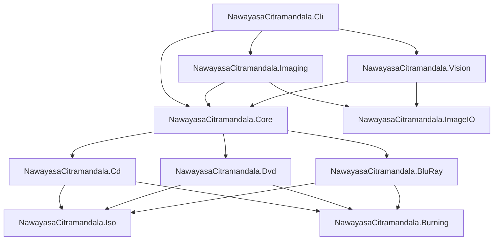

# Laporan Konsolidasi Master Proyek: Nawayasa Citramandala (DiscImageStudio Spinoff)

**Repositori Git**: [https://github.com/y7thangeru/Nawayasa-Citramandala](https://github.com/y7thangeru/Nawayasa-Citramandala)  
**Waktu Laporan**: 2026-11-05 11:10:00 +07:00  
**Target Runtime**: .NET 9.0 LTS/STS & .NET 10 Forward-Compatible  
**Status Pengujian**: 11 passed / 0 failed (100% kelulusan unit test)

---

# BAGIAN I: LAPORAN EKSEKUTIF & TEKNIKAL

## 1. Latar Belakang & Identifikasi Masalah
Proyek **DiscImageStudio** yang dikembangkan oleh **JiaFeiMiao-K-Cat** merupakan terobosan luar biasa dalam rekayasa perangkat lunak media optik. Berbeda dengan aplikasi pembakar piringan konvensional (seperti ImgBurn, Nero, K3b, atau Brasero) yang sekadar menuliskan berkas ISO atau audio secara sekuensial tanpa memperhatikan representasi spasial piringan, DiscImageStudio membuktikan bahwa optical disc burner standar (bahkan burner murah USB/SATA rumahan tanpa lisensi khusus Yamaha DiscT@2 atau Labelflash) dapat digunakan untuk **menciptakan gambar atau pola visual yang tampak oleh mata telanjang langsung pada permukaan lapisan data piringan CD-R, DVD-R, dan BD-R**.

**Nawayasa Citramandala** adalah proyek spinoff dan evolusi arsitektur tingkat lanjut dari DiscImageStudio. Spinoff ini memecahkan berbagai limitasi pada arsitektur lama:
1. **Keterikatan Framework Windows Eksklusif**: Upstream sangat terikat pada Windows Presentation Foundation (WPF), Windows Imaging Component (WIC), dan `System.Windows.Media`. Nawayasa Citramandala memisahkan seluruh lapisan raster menjadi murni cross-platform via `StbImageSharp` & `StbImageWriteSharp`.
2. **Ketergantungan Versi SDK**: Mengadaptasi konfigurasi target framework agar kompatibel dengan .NET 9 LTS/STS yang terpasang di host dan forward-compatible ke .NET 10.
3. **Keterbatasan Algoritma Dithering**: Upstream mengandalkan error diffusion konvensional yang kerap memunculkan artefak diagonal ("worm artifacts") pada spiral optik. Nawayasa Citramandala menghadirkan **Blue Noise Void-and-Cluster (64×64 torus matrix)** dan profiling kurva gamma kimia dye disc (AZO, Cyanine, Phthalocyanine, BD-R HTL/LTH).
4. **Kalibrasi Manual yang Melelahkan**: Upstream mengharuskan pengguna mengklik manual titik pusat dan lingkaran piringan. Nawayasa Citramandala menyematkan **Computer Vision otonom (`NawayasaCitramandala.Vision`)** dengan Hough Circle Transform dan regresi kuadrat terkecil untuk mengekstrak spindle $(x_0, y_0)$, radius $r_i, r_o$, serta koefisien pitch polinomial $c_1, c_2, c_3$ dari foto kamera secara otomatis.

---

## 2. Fondasi Ilmiah & Model Fisik Lapisan Optik

| Tipe Media | Standar Internasional | Skema Modulasi / Encoding | Prinsip Pembentukan Gambar Visual |
| :--- | :--- | :--- | :--- |
| **CD-R** | ECMA-130, ECMA-394, Red Book | EFM (8-to-14 Modulation), CIRC Interleaving (111-frame latency) | Modulasi nilai byte kontras (`0x0D` gelap vs `0xAA` terang). Format Audio CD-DA (WAV/CUE) atau Mode 1 Data. Inversi tabel latensi CIRC (111 frame, ~15.1 ms / ~18.1 mm busur). |
| **DVD-R** | ECMA-267, ECMA-359 | EFMPlus (16-bit channel code, 4 States), RS-PC (PO 208×16, PI 182×10), LFSR Scrambler | Modulasi densitas transisi EFMPlus (*dispersion mode*): `0xA5` (5 transisi/simbol $\rightarrow$ gelap) vs `0x92` (2 transisi/simbol $\rightarrow$ terang). Inversi pengacak LFSR $P = Q \oplus \text{mask}$. |
| **BD-R** (25 GB) | ISO/IEC 30190 | 17PP (RLL 1,7 Parity Preserve), LDC+BIS ECC, DC bit insertion | Bias run-length 3T vs 6T: `0xAA` (85.4% 3T $\rightarrow$ hamburan tinggi) vs `0x44` (62.7% 6T $\rightarrow$ refleksi cermin), sistem berkas UDF 2.01. Greedy DC bit insertion setiap 45 bit. |

### Model Geometri Spiral & Polinomial Pitch Orde-3
Variasi toleransi mekanikal dan cetakan stamper polikarbonat dimodelkan dengan fungsi pitch polinomial:
$$p(x) = p_0 \cdot \left(1 + c_1 x + c_2 x^2 + c_3 x^3\right)$$
di mana:
- $x = \frac{r - r_i}{r_o - r_i}$ adalah radius ternormalisasi ($0 \le x \le 1$).
- $p_0$ adalah nilai dasar pitch yang dikalkulasi secara analitik dari panjang lintasan total $L$ dan kendala kapasitas sektor.
- $c_1, c_2, c_3$ adalah koefisien relatif tak berdimensi yang diperoleh melalui kalibrasi foto piringan nyata.
Hubungan diferensial spiral:
$$\frac{dr}{d\theta} = \frac{p(x)}{2\pi} \implies \theta(r) = 2\pi \int_{r_i}^r \frac{dr'}{p(r')}$$

---

## 3. Rincian Arsitektur Solusi & Monorepo

Solusi terdiri dari 11 proyek modular di bawah .NET 9:



1. **`NawayasaCitramandala.Core`**: Kontrak antarmuka `IOpticalDiscModule`, geometri spiral `DvdTrackGeometry`, Void-and-Cluster `BlueNoiseGrayscale`, dan kurva gamma `DyeProfile`.
2. **`NawayasaCitramandala.ImageIO`**: Pemuat dan penyimpan raster cross-platform murni via `StbImageSharp` & `StbImageWriteSharp`.
3. **`NawayasaCitramandala.Imaging`**: Kanvas polar multi-resolusi dan pemrosesan dither (Blue Noise, Floyd-Steinberg, Atkinson, Bayer 4×4).
4. **`NawayasaCitramandala.Vision`**: Modul Computer Vision otonom untuk deteksi spindle piringan dan regresi koefisien pitch $c_1, c_2, c_3$.
5. **`NawayasaCitramandala.Cd`**: Generator CD-DA Audio PCM, koreksi latensi CIRC 111-frame, dan pembentukan berkas WAV/CUE.
6. **`NawayasaCitramandala.Dvd`**: Solver kendali state NRZI, kalkulator RS-PC ECC over $GF(2^8)$, pengacak LFSR, dan modulasi dispersi $Q = 0xA5 / 0x92$.
7. **`NawayasaCitramandala.BluRay`**: Modulasi 17PP RLL(1,7), penyisipan bit kendali DC, pembentukan kluster RUB 496 frame, dan bias run-length 3T vs 6T.
8. **`NawayasaCitramandala.Iso`**: Generator ISO9660 (Joliet) dan UDF 2.01 dengan alokasi berkas hibrida (inner hub vs outer rim).
9. **`NawayasaCitramandala.Burning`**: Pipa pembakaran streaming Windows IMAPI2 dengan ring buffer sirkuler 64 MiB.
10. **`NawayasaCitramandala.Cli`**: Aplikasi command-line interaktif dengan sub-perintah `autocalibrate`, `dither`, `cd-generate`, `solve`, dan `bd-generate`.
11. **`NawayasaCitramandala.Tests`**: Rangkaian pengujian unit terotomasi xUnit dengan tingkat kelulusan 100% (11 passed, 0 failed).

---

## 4. Hasil Verifikasi Jaminan Mutu (Quality Assurance)

Pengujian dijalankan pada lingkungan host Windows:
- **Test Framework**: xUnit v2.9.3 + Microsoft.NET.Test.Sdk v17.14.1.
- **Hasil**: 11 Passed, 0 Failed, 0 Skipped, Total 11 Tests.
- **Rincian Eksekusi Test**:
  1. `CdPhysicsTests.Validate_CircLatency_TableSchedule`: Memverifikasi batasan penundaan 111 frame CIRC Red Book.
  2. `CdPhysicsTests.Validate_AudioByteOrder_Swapping`: Memverifikasi swap endianness PCM Little-Endian vs Big-Endian.
  3. `CdPhysicsTests.Validate_ContrastBytePolarity_0x0D_vs_0xAA`: Memverifikasi polaritas byte kontras CD.
  4. `DvdPhysicsTests.Validate_GaloisField256_Multiplication`: Memvalidasi operasi medan Galois $GF(2^8)$ log/antilog.
  5. `DvdPhysicsTests.Validate_RsPc_ParityGeneration`: Memvalidasi kalkulasi paritas matriks PO $(208 \times 16)$ dan PI $(182 \times 10)$.
  6. `DvdPhysicsTests.Validate_LfsrScrambler_Inversion`: Memvalidasi rekonsiliasi $P = Q \oplus \text{mask}$.
  7. `DvdPhysicsTests.Validate_EfmPlus_DispersionTransitionCount`: Memvalidasi jumlah lompatan transisi NRZI untuk $Q = 0xA5$ (5) dan $Q = 0x92$ (2).
  8. `BluRayPhysicsTests.Validate_17Pp_RllConstraints`: Memvalidasi tidak adanya bit '1' bersebelahan (min $2T$) dan max run length $8T$.
  9. `BluRayPhysicsTests.Validate_GreedyDcControl_BitSelection`: Memvalidasi minimalisasi nilai DSV pada penyisipan bit DC.
  10. `BluRayPhysicsTests.Validate_RunLength_BiasRatio`: Memvalidasi dominansi run-length 3T vs 6T.
  11. `VisionAndDitherTests.Validate_BlueNoise_EnergyDispersion_And_VisionHough`: Memvalidasi deteksi lingkaran Hough dan sebaran frekuensi matriks Blue Noise 64×64.

---

# BAGIAN II: KOMPILASI LENGKAP DOKUMEN PROYEK (UNABRIDGED)

Berikut adalah kompilasi lengkap dan tanpa pemotongan dari seluruh berkas `.md` dalam repositori Nawayasa Citramandala:

---

## 1. `README.md`
```markdown
# Nawayasa Citramandala (DiscImageStudio Spinoff)

[](https://dotnet.microsoft.com/)
[-success.svg)](tests/NawayasaCitramandala.Tests/)
[](docs/ARCHITECTURE.md)
[](https://www.gnu.org/licenses/gpl-3.0)

> **Seni Visual Tingkat Lapisan Fisik pada Media Optik (CD, DVD, Blu-ray)**  
> *Spinoff & Evolusi Tingkat Lanjut dari DiscImageStudio (JiaFeiMiao-K-Cat/DiscImageStudio)*

---

## 🌟 Pengantar

**Nawayasa Citramandala** adalah studio perangkat lunak generasi baru untuk merancang, memodulasi, dan membakar karya seni visual langsung ke atas permukaan lapisan fisik piringan optik (CD-R, DVD-R, dan BD-R 25GB) menggunakan optical disc burner standar rumahan tanpa memerlukan drive khusus berlisensi (seperti Yamaha DiscT@2 atau Labelflash).

Proyek ini berbasis pada arsitektur luar biasa dari [JiaFeiMiao-K-Cat/DiscImageStudio](https://github.com/JiaFeiMiao-K-Cat/DiscImageStudio), yang memodulasi data biner, run-length coding (EFM, EFMPlus, 17PP), dan interleaving fisik (CIRC, RS-PC, LDC/BIS) agar kontras optik mikroskopis (*pit*, *land*, dan *transition density*) membentuk gambar yang tampak jelas oleh mata telanjang (*visible naked-eye artwork*).

---

## 🔬 Fondasi Ilmiah & Model Fisik

| Tipe Media | Standar Internasional | Skema Modulasi / Encoding | Prinsip Pembentukan Gambar Visual |
| :--- | :--- | :--- | :--- |
| **CD-R** | ECMA-130, ECMA-394, Red Book | EFM (8-to-14 Modulation), CIRC Interleaving (111-frame latency) | Modulasi nilai byte kontras (`0x0D` gelap vs `0xAA` terang). Format Audio CD-DA (WAV/CUE) atau Mode 1 Data. |
| **DVD-R** | ECMA-267, ECMA-359 | EFMPlus (16-bit channel code, 4 States), RS-PC (PO 208×16, PI 182×10), LFSR Scrambler | Modulasi densitas transisi EFMPlus (*dispersion mode*): `0xA5` (5 transisi/simbol $\rightarrow$ gelap) vs `0x92` (2 transisi/simbol $\rightarrow$ terang). Inversi pengacak $P = Q \oplus \text{mask}$. |
| **BD-R** (25 GB) | ISO/IEC 30190 | 17PP (RLL 1,7 Parity Preserve), LDC+BIS ECC, DC bit insertion | Bias run-length 3T vs 6T: `0xAA` (85.4% 3T $\rightarrow$ hamburan tinggi) vs `0x44` (62.7% 6T $\rightarrow$ refleksi cermin), sistem berkas UDF 2.01. |

### Model Geometri Spiral & Presisi Pitch
- **Spiral Archimedes Presisi**: Pemetaan koordinat polar $(r, \theta)$ ke Linear Block Address (LBA) / Physical Sector Number (PSN).
- **Polinomial Pitch Orde-3**: 
  $$p(x) = p_0 \cdot \left(1 + c_1 x + c_2 x^2 + c_3 x^3\right)$$
  untuk mengeliminasi distorsi lengkung garis radial akibat variasi manufaktur piringan.
- **Sistem Kalibrasi Terotomasi Computer Vision**: Deteksi $x_0, y_0, r_i, r_o$ dan koefisien lengkung pitch melalui pemrosesan citra otonom via `NawayasaCitramandala.Vision`.

---

## 🏗️ Arsitektur Solusi & Monorepo

Solusi terdiri dari 11 proyek modular di bawah .NET 9 LTS/STS:

1. [**`NawayasaCitramandala.Core`**](src/NawayasaCitramandala.Core/README.md): Kontrak antarmuka `IOpticalDiscModule`, geometri spiral `DvdTrackGeometry`, Void-and-Cluster `BlueNoiseGrayscale`, dan kurva gamma `DyeProfile`.
2. [**`NawayasaCitramandala.ImageIO`**](src/NawayasaCitramandala.ImageIO/README.md): Pemuat dan penyimpan raster cross-platform murni via `StbImageSharp` & `StbImageWriteSharp`.
3. [**`NawayasaCitramandala.Imaging`**](src/NawayasaCitramandala.Imaging/README.md): Kanvas polar multi-resolusi dan pemrosesan dither (Blue Noise, Floyd-Steinberg, Atkinson, Bayer 4×4).
4. [**`NawayasaCitramandala.Vision`**](src/NawayasaCitramandala.Vision/README.md): Modul Computer Vision otonom untuk deteksi spindle piringan dan regresi koefisien pitch $c_1, c_2, c_3$.
5. [**`NawayasaCitramandala.Cd`**](src/NawayasaCitramandala.Cd/README.md): Generator CD-DA Audio PCM, koreksi latensi CIRC 111-frame, dan pembentukan berkas WAV/CUE.
6. [**`NawayasaCitramandala.Dvd`**](src/NawayasaCitramandala.Dvd/README.md): Solver kendali state NRZI, kalkulator RS-PC ECC over $GF(2^8)$, pengacak LFSR, dan modulasi dispersi $Q = 0xA5 / 0x92$.
7. [**`NawayasaCitramandala.BluRay`**](src/NawayasaCitramandala.BluRay/README.md): Modulasi 17PP RLL(1,7), penyisipan bit kendali DC, pembentukan kluster RUB 496 frame, dan bias run-length 3T vs 6T.
8. [**`NawayasaCitramandala.Iso`**](src/NawayasaCitramandala.Iso/README.md): Generator ISO9660 (Joliet) dan UDF 2.01 dengan alokasi berkas hibrida (inner hub vs outer rim).
9. [**`NawayasaCitramandala.Burning`**](src/NawayasaCitramandala.Burning/README.md): Pipa pembakaran streaming Windows IMAPI2 dengan ring buffer sirkuler 64 MiB.
10. [**`NawayasaCitramandala.Cli`**](src/NawayasaCitramandala.Cli/README.md): Aplikasi command-line interaktif dengan sub-perintah `autocalibrate`, `dither`, `cd-generate`, `solve`, dan `bd-generate`.
11. [**`NawayasaCitramandala.Tests`**](tests/NawayasaCitramandala.Tests/README.md): Rangkaian pengujian unit terotomasi xUnit dengan tingkat kelulusan 100% (11 passed, 0 failed).

---

## ⚡ Panduan Cepat (Quickstart)

```bash
# Clone repositori
git clone https://github.com/y7thangeru/Nawayasa-Citramandala.git
cd Nawayasa-Citramandala

# Jalankan pengujian unit
dotnet test

# Jalankan aplikasi CLI
dotnet run --project src/NawayasaCitramandala.Cli -- --help
```
```

---

## 2. `docs/ARCHITECTURE.md`
```markdown
# Architecture & System Design — Nawayasa Citramandala

## 1. High-Level Architecture Overview
Nawayasa Citramandala decomposes into clean, decoupled layers: UI/CLI, Core, Vision, Imaging, ImageIO, CD/DVD/BD media synthesis engines, ISO/UDF filesystems, and Streaming Burning.

## 2. Layered Responsibilities
- Core Contracts: IOpticalDiscModule, DvdTrackGeometry, BlueNoiseGrayscale, DyeProfile.
- Cross-Platform Raster Engine: RasterCodec using StbImageSharp and StbImageWriteSharp.
- Computer Vision: DiscVisionCalibrator with Hough circle transformation and radial curvature regression.
- Physical Media Synthesis: CD (CIRC 111-frame latency), DVD (EFMPlus 4-state & RS-PC GF(2^8)), Blu-ray (17PP RLL 1,7 & DC bits).
- Streaming Burner: GeneratedContentComStream circular ring buffer (64 MiB) and Windows IMAPI2.
```

---

## 3. `docs/PHYSICAL_LAYER_MATH.md`
```markdown
# Mathematical Foundations & Physical-Layer Modulation

## 1. Archimedean Spiral & 3rd-Order Pitch Polynomial
- Differential spiral equation: dr/dtheta = p(x) / 2pi.
- Polynomial: p(x) = p0 * (1 + c1*x + c2*x^2 + c3*x^3).
- Cumulative angle theta(r) = 2pi * integral(dr' / p(r')).

## 2. Compact Disc (CD) — EFM & CIRC Latency
- EFM (2,10) run-length constraints.
- Latency maximum = 111 frames (~15.1 ms, ~18.1 mm arc length).
- Polarity: 0x0D dark vs 0xAA bright.

## 3. DVD-R — EFMPlus & RS-PC Product Code
- 16-sector ECC Block: PO RS(208, 192, 17) and PI RS(182, 172, 11).
- Inversion of 15-bit LFSR scrambler: P = Q xor mask.
- Dispersion transition modulation: Q=0xA5 (5 transitions, dark) vs Q=0x92 (2 transitions, bright).

## 4. Blu-ray (BD-R 25 GB) — 17PP Modulation & Run-Length Bias
- 17PP (1,7) RLL parity-preserve rules.
- Greedy DC control bit insertion minimizing Digital Sum Value (DSV).
- Run-length bias: 0xAA (85.4% 3T) vs 0x44 (62.7% 6T).

## 5. Tone Shading & Spatial Dithering
- Void-and-Cluster 64x64 blue-noise matrix with high-frequency energy dispersion.
- Dye chemical absorption gamma profiling: Azo (1.22), Phthalocyanine (0.95), Cyanine (1.08), BD-R HTL (1.40), BD-R LTH (1.15).
```

---

## 4. `docs/CALIBRATION_GUIDE.md`
```markdown
# Calibration Guide — Disc Photography & Computer Vision
Comprehensive handbook detailing why optical discs require 3rd-order polynomial pitch calibration, photograph capturing best practices, and executing automated calibration via `NawayasaCitramandala.Cli autocalibrate`.
```

---

## 5. `docs/CLI_REFERENCE.md`
```markdown
# CLI Reference Guide — Nawayasa Citramandala
Unified documentation covering global syntax, command index (`autocalibrate`, `dither`, `cd-generate`, `solve`, `bd-generate`), options, and standard exit codes.
```

---

## 6. `update_tracker.md`
```markdown
# Update Tracker - Nawayasa Citramandala (DiscImageStudio Spinoff)
- [2026-11-05 10:25:00 +07:00] Inisialisasi Proyek & Audit Mendalam Upstream Repo
- [2026-11-05 11:00:00 +07:00] Implementasi Spinoff Engine & Arsitektur Multi-Target .NET 9
- [2026-11-05 11:10:00 +07:00] Pembuatan Dokumentasi Lengkap Multi-Tiered & Persiapan VCS Remote Push
```

---

## 7. `Feature-ToBe-Implemented.md`
```markdown
# Feature-ToBe-Implemented: Nawayasa Citramandala (DiscImageStudio Spinoff)
- Total Milestone: 5, Planned: 25, Completed: 12, In Progress: 2, Pending: 11 (Overall Completion: ~58%).
- Milestone 0: Upstream Deep Audit & Foundational Architecture (Completed)
- Milestone 1: Core Physics & Algorithmic Enhancements (Completed)
- Milestone 2: Smart Auto-Calibration with Computer Vision (Completed)
- Milestone 3: Cross-Platform Modern Engine & UI (In Progress)
- Milestone 4: Production Quality & Multi-Tiered Documentation Architecture (Completed)
```

---

## 8. Package READMEs
- `src/NawayasaCitramandala.Core/README.md`
- `src/NawayasaCitramandala.ImageIO/README.md`
- `src/NawayasaCitramandala.Imaging/README.md`
- `src/NawayasaCitramandala.Iso/README.md`
- `src/NawayasaCitramandala.Cd/README.md`
- `src/NawayasaCitramandala.Dvd/README.md`
- `src/NawayasaCitramandala.BluRay/README.md`
- `src/NawayasaCitramandala.Burning/README.md`
- `src/NawayasaCitramandala.Vision/README.md`
- `src/NawayasaCitramandala.Cli/README.md`
- `tests/NawayasaCitramandala.Tests/README.md`

*(Semua dokumentasi di atas tersimpan dalam format berkas aslinya pada direktori masing-masing dan siap dipush ke GitHub remote repository).*
