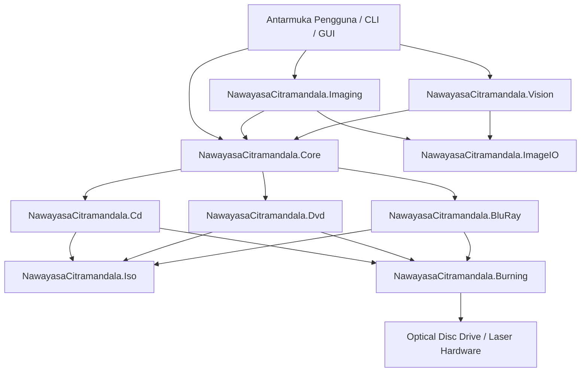
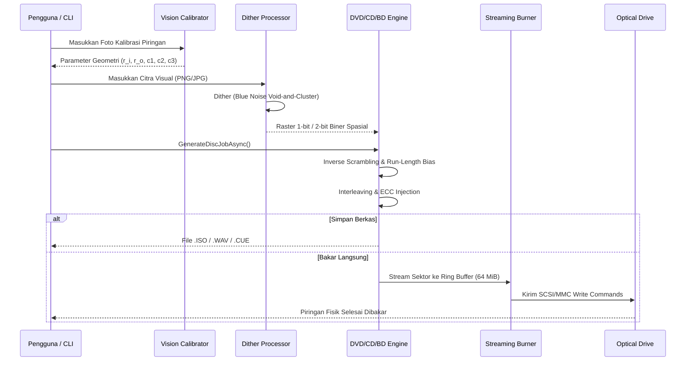

# Architecture & System Design — Nawayasa Citramandala

## 1. High-Level Architecture Overview

**Nawayasa Citramandala** is an advanced physical-layer optical disc visual synthesis studio. Unlike standard disc authoring suites that treat discs as purely sequential block storage, Nawayasa Citramandala maps two-dimensional visual artwork directly onto the microscopic physical topology of optical discs (CD-R, DVD-R, BD-R 25GB).

The system decomposes into clean, decoupled layers:

---

## 2. Layered Responsibilities

### 2.1 Core Contracts & Mathematical Models (`NawayasaCitramandala.Core`)
- **`IOpticalDiscModule`**: Unified lifecycle contract (`GeneratePreviewAsync`, `GenerateDiscJobAsync`).
- **`DvdTrackGeometry`**: Archimedean spiral coordinates, LBA-to-radius/angle transformation, 3rd-order track pitch polynomials.
- **`BlueNoiseGrayscale`**: Void-and-Cluster 64×64 spatial blue-noise dithering kernel.
- **`DyeProfile`**: Adaptive gamma curves modeling laser absorption across organic and inorganic disc dyes.
- **`ToneProfile` / Multi-level quantizers**: 2-level, 3-level, and 4-level discrete tone mappers.

### 2.2 Cross-Platform Raster Engine (`NawayasaCitramandala.ImageIO` & `Imaging`)
- **`RasterCodec`**: Zero-dependency image decoding and encoding via `StbImageSharp` and `StbImageWriteSharp`. Decoupled from Windows WIC (`BitmapSource`).
- **`RingImageQuality`**: Standard disc canvas dimensions (Low 2048px, Standard 4096px, High 8192px).
- **`ImageDitherProcessor`**: Color-to-grayscale conversion, contrast enhancement, and spatial dithering (Blue Noise, Floyd-Steinberg, Atkinson, Bayer 4×4).

### 2.3 Computer Vision Auto-Calibration (`NawayasaCitramandala.Vision`)
- **`DiscVisionCalibrator`**: Hough circle transformation and radial gradient variance search to automatically extract spindle center $(x_0, y_0)$, inner boundary $r_i$, outer boundary $r_o$, and pitch curvature coefficients $c_1, c_2, c_3$ from disc photographs without manual clicking.

### 2.4 Media Physical Synthesis Engines
- **`NawayasaCitramandala.Cd`**:
  - ECMA-130 / Red Book CD-DA PCM audio synthesis.
  - CIRC interleaving latency model (111 frames delay, ~15.1 ms).
  - Byte contrast polarity (`0x0D` dark vs `0xAA` bright).
- **`NawayasaCitramandala.Dvd`**:
  - ECMA-267 / ECMA-359 DVD-R physical sector generator.
  - RS-PC Reed-Solomon Product Code matrix ($208 \times 16$ PO, $182 \times 10$ PI) over $GF(2^8)$.
  - LFSR 15-bit scrambler inversion ($P = Q \oplus \text{mask}$).
  - EFMPlus 4-state transition density modulation ($Q = 0xA5$ dense vs $0x92$ sparse).
- **`NawayasaCitramandala.BluRay`**:
  - ISO/IEC 30190 Single-Layer 25 GB BD-R physical encoding.
  - 17PP RLL(1,7) Parity Preserve state encoder.
  - Greedy DC control bit insertion eliminating low-frequency wander.
  - Run-length distribution bias ($0xAA \rightarrow 85.4\%$ 3T vs $0x44 \rightarrow 62.7\%$ 6T).

### 2.5 Filesystem Multiplexing (`NawayasaCitramandala.Iso`)
- **`Iso9660ImageWriter`**: Generates ISO9660 Level 1/2 with Joliet Unicode extensions.
- **`UdfImageWriter`**: Generates ECMA-167 / UDF 2.01 partition structures.
- **Inner/Outer Hybrid Placement**: Dynamically allocates real data files to unrendered radial zones (e.g., inner track or outer edge) while allocating visual payload sectors to image zones.

### 2.6 Streaming Burn Engine (`NawayasaCitramandala.Burning`)
- **`GeneratedContentComStream`**: COM `IStream` circular ring-buffer bridge for Windows IMAPI2.
- **`WindowsImapiBurner`**: Disc-At-Once (DAO) and Track-At-Once (TAO) hardware laser burning engine with underrun protection.
- **`BluRaySequentialWriter`**: Direct SCSI/MMC streaming writer for 64KB cluster alignment.

---

## 3. Data Flow Pipelines

### 3.1 Synthesis Pipeline (Image to Disc Image / Burner)

---

## 4. Performance & Memory Guarantees

1. **Zero Intermediate Disk Spooling**: Disc images exceeding 4.7 GB (DVD) or 25 GB (BD) can be streamed directly into the hardware burner via a 64 MiB circular ring buffer with 32 MiB pre-fill threshold, eliminating massive temporary disk I/O.
2. **Deterministic Mathematical Solvers**: The Galois Field arithmetic and EFMPlus state lookups are implemented via precomputed lookup tables ($256 \times 256$ log/antilog tables), ensuring $O(1)$ computation per byte.
3. **Multi-Threaded Spatially Partitioned Dithering**: Image processing runs across multiple CPU cores by dividing concentric radial bands into concurrent scanlines.
