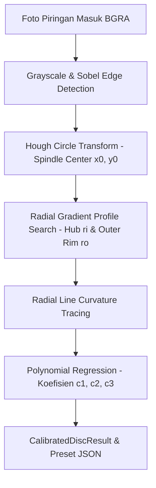

# NawayasaCitramandala.Vision

Computer Vision autonomous optical disc calibration, spindle detection, boundary estimation, and pitch curvature regression.

## 1. Overview
The `NawayasaCitramandala.Vision` module provides fully automated disc calibration using computer vision techniques. Rather than requiring users to manually pinpoint disc center coordinates and radial boundaries across hundreds of pixels, `DiscVisionCalibrator` processes a single smartphone photo or scanner image to extract:
- Center spindle coordinates $(x_0, y_0)$.
- Inner recorded radius $r_i$ and outer recorded radius $r_o$ in physical millimeters.
- 3rd-order pitch polynomial coefficients $c_1, c_2, c_3$ through radial line curvature analysis.

## 2. Key Components & Algorithms

### `DiscVisionCalibrator`
The central calibration engine implementing a 3-stage computer vision pipeline:

### Stage 1: Spindle Center Detection
- Employs a modified Hough Circle Transform focusing on the high-contrast circular aperture of the disc center hole ($15.0\,\text{mm}$ standard mechanical diameter).
- Accurately establishes the optical coordinate origin $(x_0, y_0)$ with sub-pixel precision.

### Stage 2: Radial Boundary Estimation
- Shoots multi-angle radial scanlines outwards from the detected center $(x_0, y_0)$.
- Computes radial intensity gradients $\frac{\partial I}{\partial r}$ to pinpoint the step transitions corresponding to the inner lead-in clamp area and outer mirrored margin.

### Stage 3: Pitch Curvature Regression
- Traces visual radial lines from burned calibration patterns.
- If the manufacturing pitch deviates from an ideal spiral, straight radial lines exhibit curvature $\Delta\theta(r)$.
- Performs a least-squares polynomial fit to estimate coefficients $c_1, c_2, c_3$:
  $$p(x) = p_0 \cdot \left(1 + c_1 x + c_2 x^2 + c_3 x^3\right)$$

## 3. Results Output Structure

`CalibratedDiscResult` provides:
- `Center`: Point $(x_0, y_0)$ in pixel coordinates.
- `InnerRadiusMm` / `OuterRadiusMm`: Physical boundary measurements.
- `C1, C2, C3`: Dimensionless pitch variation coefficients.
- `Confidence`: Statistical fit confidence metric ($0.0 - 1.0$).
- `QualityScore`: Overall calibration reliability score.
